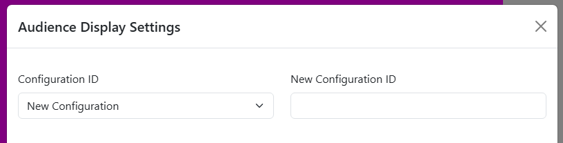
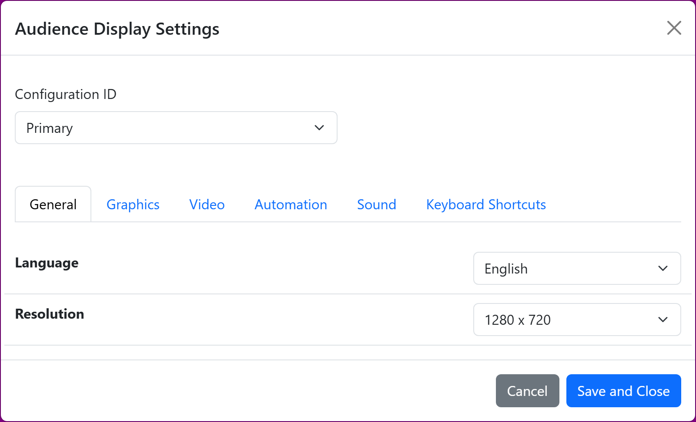
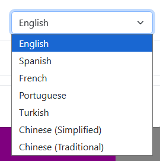
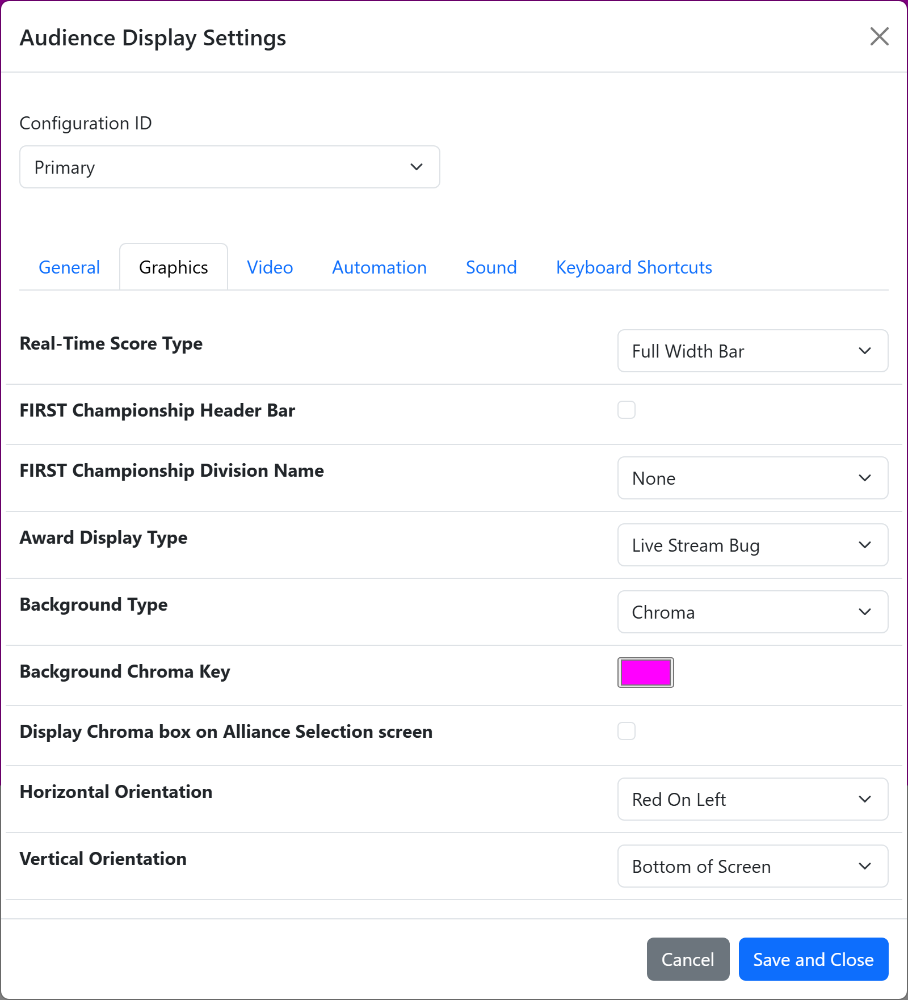
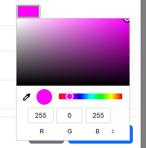
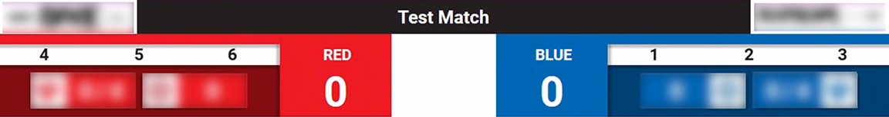
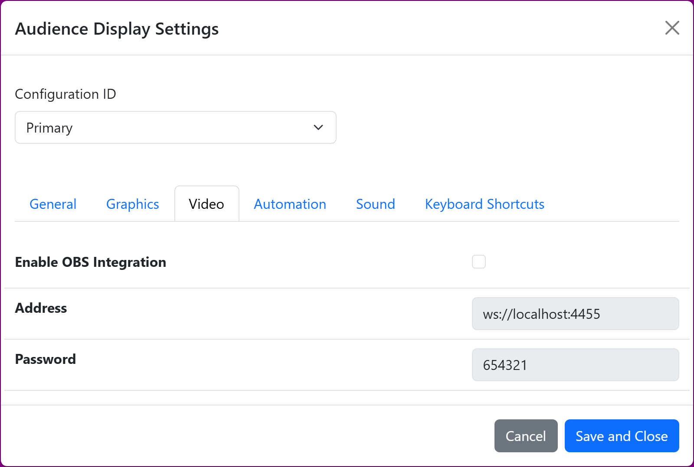
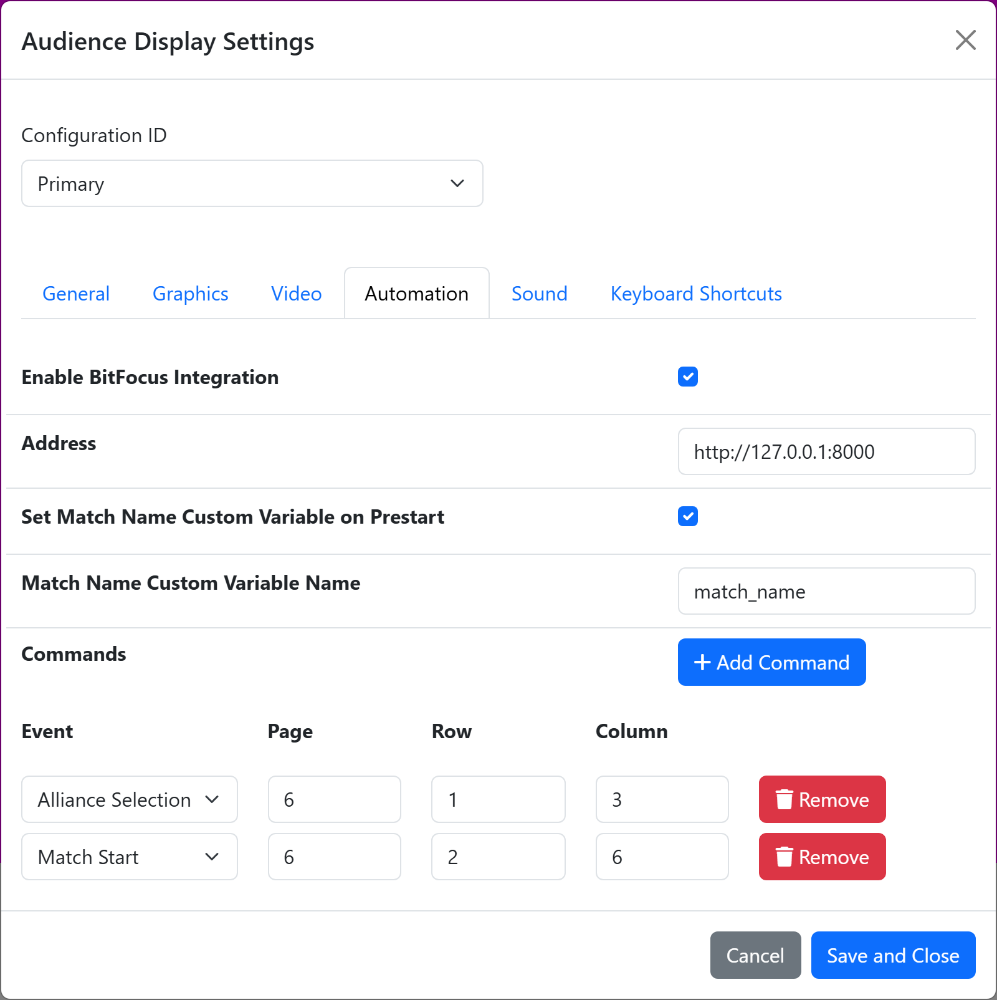
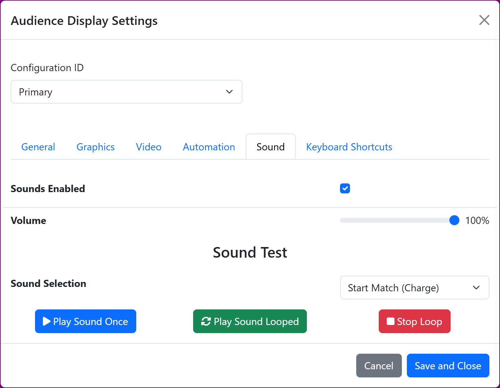
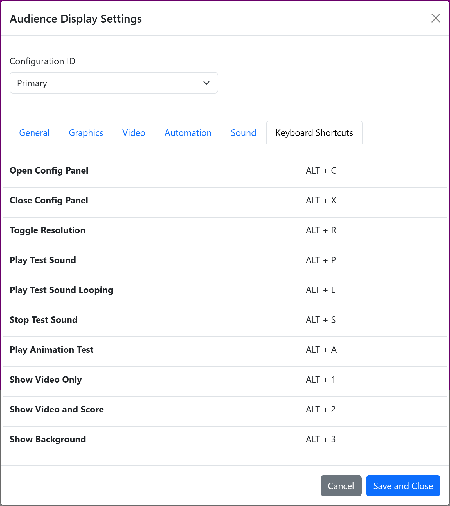

.. include:: <isonum.txt>
.. _audience-settings-web:

Settings
========

Customize the look and feel of the Audience Display via the settings panel. Settings are specific to each Configuration ID.
Access the settings from the Audience Display hover menu by clicking *Open Settings* (the Gear icon), or use the keyboard shortcut ALT-C when the Audience Display is in focus.

The settings are grouped into tabs: General, Graphics, Video, Automation, Sound and Keyboard Shortcuts. Click *Save and Close* at the bottom of the panel
to save the settings to the selected Configuration ID. *Cancel* closes the panel without saving.

Configuration ID
----------------

|
| Use the Configuration ID dropdown to select the Configuration you want to edit. Selecting "New Configuration" will show a text box next to the dropdown for the user to enter an ID for the configuration; the ID cannot contain spaces. Once the settings are saved, the Configuration ID entered can be entered at the end of the URL to automatically load the settings from this configuration.

For example, a configuration saved with the ID ``Stream`` is loaded by opening ``http://10.0.100.5/AudienceDisplay/Stream``. Opening the Audience Display without an ID
loads the configuration named ``Primary``.

General Settings
------------------

|
| [**Language**] Audience Display is available in multiple languages- select a language from the dropdown. The available languages are English, Spanish, French, Portuguese, Turkish, Chinese (Simplified) and Chinese (Traditional).

|
| [**Resolution**] The Audience Display is available in **1280 x 720** or **1920 x 1080** resolutions. Ask your event production crew for more information. The resolution can also be switched with ALT-R or the *Toggle Resolution* button in the hover menu.

Graphics Settings
------------------

|
| -

.. note::
   Careful consideration should be used before changing these options as they can cause confusion for audience members who expect a traditional layout from year to year.
   For official FRC Events, if in doubt, contact your Engineering support contact.

[**Real-Time Score Type**]

* Live Stream Bug - Webcast version as arranged with *FIRST* HQ and provides an alternate view of the data in a more compact, centered display
* Full Width Bar - The traditional score bar that takes up the full bottom third or so of the Audience Display

[**FIRST Championship Header Bar** and **FIRST Championship Division Name**] Configuration options specific to the *FIRST* Championship. Please do not adjust these settings at any events except under the direction of FRC Support.
When the Header Bar is checked, the whole display is replaced by the Championship center screen layout. When a Division Name is selected, the Background display shows that division's logo full screen.

[**Award Display Type**]

* Live Stream Bug - Show award names and award winners in a simplified web friendly display on top of the camera view
* Fullscreen - Show award names and award winners full screen without space for chroma (camera shots)

[**Background Type**]

* Chroma - Show the selected color in the area to be keyed (or cut) out and replaced with live event video from a camera or production feed. The actually "keying" process and
  mixing of video would need to be done through external software, not through FMS/Audience Display.

* Rankings / Bracket - Removes the background screen color (Chroma) and shows a ranking screen in its place. The list automatically scrolls through all the ranked teams at
  the event, in rank order. Teams must have played one or more qualification matches to be included in the listings. During Playoff matches, the rankings are replaced with the playoff
  bracket to show progression through the tournament. During Practice matches, or when no schedule is active, the Background display is shown instead.

* Transparent - Displays nothing behind the graphics in the audience display, allowing for easy use in video editing software such as OBS.

.. note::
   Updates to the qualification rankings via out-of-band processes (such as Match Review) will not update the rankings if the rankings are on screen during the update process; to update rankings, the Video Switch must be used to select
   another view (such as "Background") and then reload the desired view ("Video Only" or "Video and Score").

[**Background Chroma Key**] Select the color to be used for the Chroma Key. This setting is only shown when the Background Type is Chroma. In most cases, the default "Fuchsia" should work great. The desired color will be dictated by the event's production
group.

[**Display Chroma box on Alliance Selection screen**] When checked, the Alliance Selection screen includes a box in the Chroma Key color, intended to be keyed out and replaced with a camera shot.

|
| -

.. warning::
   Avoid using common colors like "red" or "blue" as Chroma Key colors, as they will also cause portions of the other graphics (like the *FIRST* logo) to be keyed out.

|
| [**Horizontal Orientation**] *Red On Left* or *Red On Right*. The red alliance is setup to the right side when viewed from the scoring table. As such, a projection screen mounted behind the scoring
    table (viewed by the audience sitting across from it) would see the red alliance on the left side when viewing the field. However, in some venue setups this configuration
    is not viable. In these situations the horizontal orientation can be flipped so that the display will properly align overlayed elements with those seen on the live video feed.

[**Vertical Orientation**] Move the real time score display to the *Top of Screen* or the *Bottom of Screen* based on venue needs.

Video Settings
--------------

|
| [**Enable OBS Integration**] Instruct the Audience Display to issue commands that can be detected by OBS (a broadcast software). For more information see :ref:`this article <audience-automation-obs>`

[**Address**] The address of the OBS Websocket server, starting with ``ws`` and including the port number. Only available when OBS Integration is enabled.

[**Password**] The password configured for the OBS Websocket server. Only available when OBS Integration is enabled.

Automation Settings
--------------------

|
| [**Enable BitFocus Integration**] Instruct the Audience Display to issue commands that can be detected by BitFocus Companion (an A/V and production control program). For more information see :ref:`this article <audience-automation-bitfocus>`

[**Address**] The address of the Companion installation, written as a full URL including the port.

[**Set Match Name Custom Variable on Prestart** and **Match Name Custom Variable Name**] When checked, the Audience Display sets the named Companion custom variable to the name of the match each time a match is Prestarted.

[**Commands**] The list of Companion buttons to press, one for each event of interest. Use *Add Command* to add a row, then choose the *Event* and enter the *Page*, *Row* and *Column* of the button. *Remove* deletes a row.

The remaining fields on this tab are only available when BitFocus Integration is enabled.

Sound Settings
------------------

|
| [**Sounds Enabled**] When unchecked, this Audience Display plays no sounds at all, including the game sounds during a match and the test sounds. Leave this checked on the Audience Display that provides game sounds to the venue. It is useful to uncheck it on additional instances, such as one used only for a webcast, so that game sounds are not played twice.

[**Volume**] The volume of all sounds played by this Audience Display, from 0% to 100%. Not available when sounds are disabled.

**Sound Test**

Select a sound from the "Sound Selection" dropdown. The game sounds, such as *Start Match (Charge)*, *End Match (Buzzer)* and *Abort (Foghorn)*, are available along with a *Test Melody*.

[**Play Sound Once**] Single play of the selected sound

[**Play Sound Looped**] Play the selected sound repeatedly. Particularly helpful when setting levels with the venue's audio crew.

[**Stop Loop**] Stop the sound that is playing

Keyboard Shortcuts
------------------

|
| Quick reference of the available shortcuts and actions in the Audience Display. The shortcuts work whenever the Audience Display is in focus; the settings panel does not need to be open.

.. list-table::
   :widths: 20 80
   :header-rows: 1

   * - Shortcut
     - Action
   * - ALT-C
     - Open the settings panel
   * - ALT-X
     - Close the settings panel
   * - ALT-R
     - Toggle the resolution between 1280 x 720 and 1920 x 1080
   * - ALT-P
     - Play the test sound once
   * - ALT-L
     - Play the test sound looping
   * - ALT-S
     - Stop the test sound
   * - ALT-A
     - Play the Match Result animation test
   * - ALT-1
     - Show Video Only
   * - ALT-2
     - Show Video and Score
   * - ALT-3
     - Show Background

.. note::
   ALT-1, ALT-2 and ALT-3 change only the Audience Display the keys are pressed on. They do not change the Video Switch in FMS or any other Audience Display. The display follows FMS again
   the next time the Scorekeeper changes the Video Switch.
