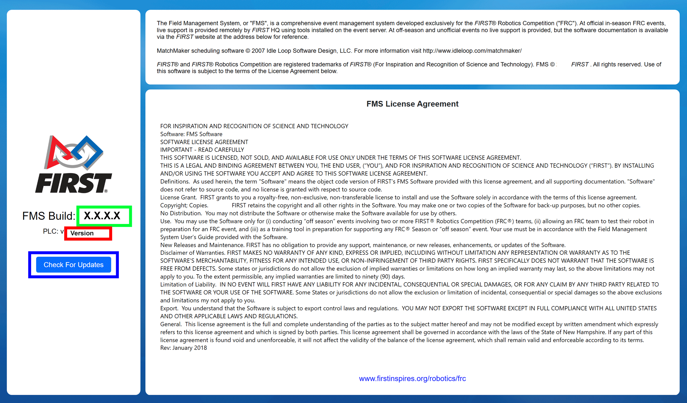

.. _about-tab:

About Tab
===========

The "About" tab contains version information and software notices. 2025 versions of FMS will always have a Major Version of "12".

[Green] Build (revision) of the software currently installed

[Red] Build (revision) of the PLC software currently installed (not applicable in Off-Season builds)

[Blue] For traditional versions of FMS, check for available updated versions and initiate the install process

The EULA software license, which was agreed to upon installation of the software, is also available for review.

There is no built in update capability in the Off-Season version of the software. In the traditional version, once an update download has been initiated,
download progress statistics will be displayed and the installation process will begin automatically.

Export Server Details
---------------------

The "Export Server Details" button at the bottom of the tab saves a description of the FMS server to a text file, for use by *FIRST* support staff when
diagnosing a problem with the server. It requires :ref:`HQ approval <hq-approval>`, so it is normally only used when event support asks for the file.

Once approved, a "Save Exported Server Details" dialog asks where to save the file. The suggested file name is the computer name followed by "_ServerDetails.server".
An "Exporting Server details..." message is shown while the file is written. The file describes the computer itself: its processor, make and model, memory, Windows installation,
monitors and network adapters (including their addresses). It does not contain any event, team or match data.

If the file cannot be written, FMS reports "There was an error while attempting to export the server details." Choose a different location and try again.
