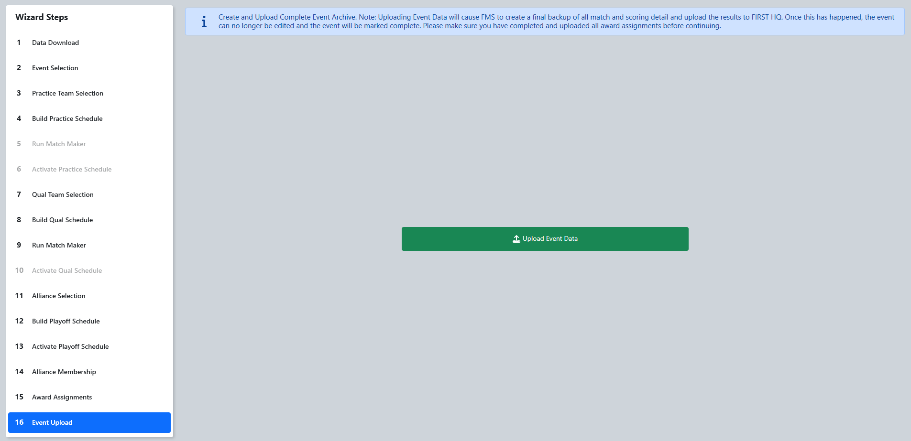

.. _event-wizard-archive-upload:

Event Upload
======================

The Event Data Upload step is used to do a complete backup of all event information. Copies are placed on the local Server, USB drive (which must be connected),
as well as uploaded to *FIRST* (provided an Internet connection is available and the event is an official *FIRST* event).
Verification is also done to confirm the upload was successful.

**DEPENDING ON THE SIZE OF THE DATABASE, THE AMOUNT OF LOG DATA STORED, AND THE SPEED OF THE INTERNET CONNECTION AT THE EVENT THIS STEP MAY TAKE UP TO 10 MINUTES!**

Status information will be shown during the Upload.

Before Uploading
################

FMS checks that the event is ready to be uploaded:

* Every award that has been assigned must be marked as public (see :ref:`event-wizard-award-assignment`)
* At Regional events, regional advancement must be determined and published (see :ref:`event-wizard-regional-advancement`)

If the event is not ready when this step is opened at an official event, a warning beginning "Event is not ready to upload:" lists what is missing, and ends
"You will not be able to upload the event archive until these issues are resolved or you receive engineering approval." Close the warning, complete the missing
items in the Event Wizard, and return to this step.

Starting the Upload
###################

Click "Upload Event Data". For an Off-Season event the button is labeled "Archive Event Data".

* If the event is still not ready (see above), the upload requires :ref:`HQ approval <hq-approval>`. The approval dialog lists what is missing. It is always better to
  resolve the items than to upload without them.
* An "Upload Event?" message (for an Off-Season event, "Archive Event?") then asks "Are you sure you have read the information on this page and want to proceed?"
  Choose "Upload" (or "Archive") to start.

Do not close FMS while the upload is running.

After the Upload
################

When an official event has been uploaded successfully, an "Upload Complete" message reads "The event upload is complete, you may now close FMS. Please contact FRC Engineering
Support before shutting down the server. Thank you for volunteering!!!"

For an Off-Season event, FMS makes a final backup and no data is uploaded to *FIRST*. The message is "Archive Complete": "The off-season event archive is complete, you may now close FMS."

In both cases the event is then finished as far as FMS is concerned. It is no longer the active event, and the Event Wizard steps after Event Selection are disabled.
Because of this, make sure the event really is over before starting this step.

If the upload does not succeed, an "Archive/Upload Failed!" error is shown. The event remains the active event and the upload can be attempted again.

If the upload fails, be sure to check the backup settings in the Settings >> Backup page and force a manual event backup.
The backup is what is used to upload, so if you find there are problems performing a manual backup this is the best place to start debugging:

* Ensure that the backup location is still present (the USB drive, in most cases)
* Ensure the backup location is set
* Ensure the backup has been performed (check the file is on the disk and there is sufficient space)
  
Performing a forced event backup will cause the backup to be generated, and the upload may be re-attempted by returning to the archive and upload step.

.. warning::
    Contact FRC Engineering before shutting down the server at the event, or if uploads are unsuccessful.
