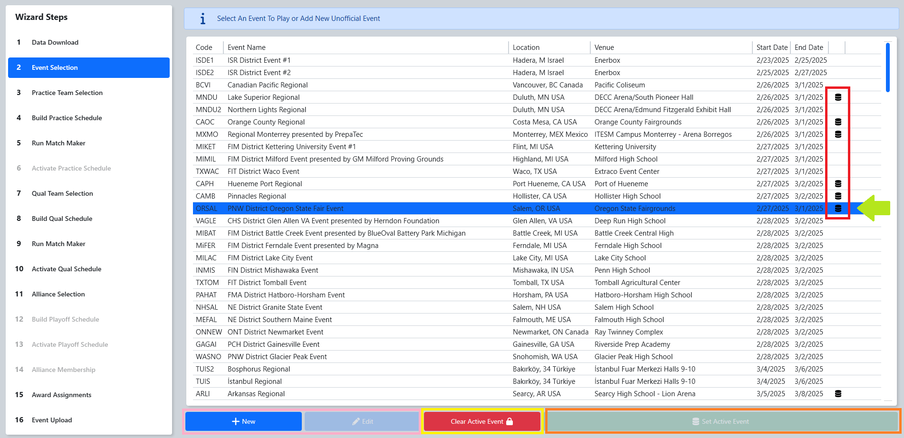
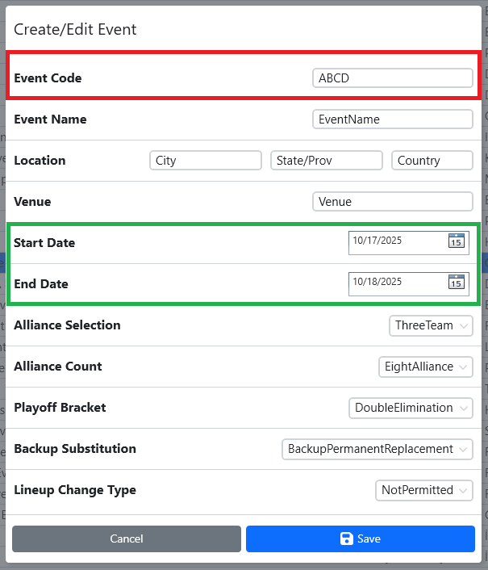
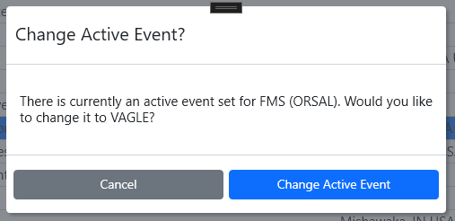
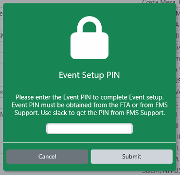
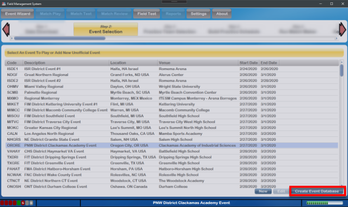
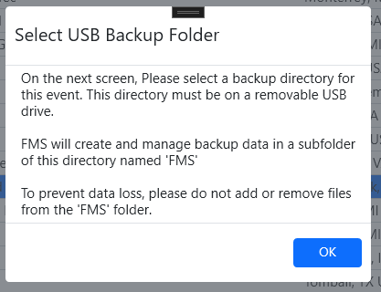
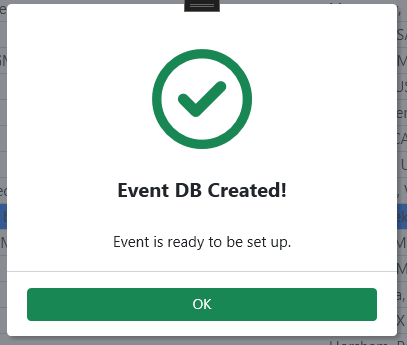

.. _event-wizard-event-selection:

Event Selection
======================

Selecting a traditional event
#############################

|
| The Event Selection step of the Event Wizard displays the complete list of events from Data Download.
	Select the event to be played by clicking on it. In this example, the selected event is shown with a green marker and highlighted blue background on the row.

[**Green Marker**] The currently selected event, if there is one, will be shown with a highlighted row background

[**Pink Box**] The "new" and "edit" buttons can be used to manipulate Off-Season events

[**Yellow Box**] Clear the currently active event in FMS and have no active event. This will disable all event wizard steps after event selection.

[**Orange Box**] Set selected event as active and create the event database if one has not been created yet (see below)

[**Red Box**] Database icon to identify events that have a database on this computer

Reminders When Opening Event Selection
######################################

When the Event Selection step is opened, FMS checks that the software and the downloaded event data are recent enough to choose a new event from.
If they are not, a reminder is shown. Each reminder can be dismissed with "Continue Anyway", and will appear again the next time the step is opened until
the check or download has been done.

* **"FMS Software Update Required"** - FMS knows that a newer version is available. The message gives the installed version and the latest available version.
* **"Software Version Check Needed"** - FMS has not checked for software updates in the last 3 days (or has never checked).

  For either of these, "Open Software Updates" goes to the :ref:`Software Updates <event-wizard-software-updates>` step instead of opening Event Selection.
  These two reminders do not appear in the Off-Season version of the software.

* **"Event Data May Be Out of Date"** - Data Sync is enabled, the last :ref:`Data Download <event-wizard-data-download>` was more than 3 days ago (or has never been run), and
  there is either no active event or the active event has reached its end date. "Open Data Download" goes to the Data Download step so the event list can be
  refreshed before a new event is selected.

Recommended Event
#################

During the competition season, when there is no active event (or the active event's end date has passed), the traditional version of the software may
recommend the event that this field is expected to be used at. This happens when the Event Selection step is opened.

* If one event is recommended, its row is selected and highlighted green, and a "Use Recommended Event?" message asks "FMS recommends (event code) - (event name).
  Set this as the active event?" Choose "Set Active Event" to continue exactly as if the "Set Active Event" button had been clicked (see `Changing Active Event`_ below),
  or "Pick Another" to clear the selection and choose an event from the list yourself.
* If more than one event is recommended, a "Recommended Events Found" message is shown and all of the recommended events are highlighted green in the list.
  Select the correct one and click "Set Active Event".

A recommendation is only a suggestion. Always confirm that the event code and name are correct for the event being played before setting it as the active event.
If no recommendation is available, nothing is shown and the event is selected from the list as usual.

Creating an Off-Season Event
##############################

|
| For FMS Off-Season, clicking "New" will allow the addition of an unofficial (Off-Season) event. Only events added with the "New" button can be edited,
	those downloaded from *FIRST* are protected from edits (including off-season events that come from *FIRST* HQ). If you've requested to sync results with *FIRST* HQ, do not manually add your event.
	Instead, use data download to receive it and use the downloaded event.

The "New" button is also present in the traditional version of the software. There, from January through April it requires :ref:`HQ approval <hq-approval>`
before the "Create/Edit Event" dialog opens. An event added with "New" is always an Off-Season event.

The Event Code (**red box**) must be unique from any other events on the machine (official events or Off-Season events).

.. note::
	Make sure the inclusive start and end dates (**green box**) are marked properly, as they are used to validate schedules.

The "Create/Edit Event" dialog also sets how the playoff tournament will be run:

* "Alliance Size" - "3 teams" or "4 teams"
* "Alliance Count" - "4 alliances" or "8 alliances"
* "Playoff Bracket" - "Double elimination" is the only choice
* "Backup Substitution" - "No backup robots" (no backup robots allowed) or "Substitution allowed" (once the backup robot has played a match, subsequent matches can include any 3 of the 4 alliance members)
* "Lineup Change Type" - "None" (no lineup changes are permitted) or "Free" (alliances may freely assign teams to stations in each match)

The same explanations are available on screen by hovering over the information icon beside "Backup Substitution" and "Lineup Change Type".
A new event starts with 3 teams, 8 alliances, "Substitution allowed" and "Free".

When "Save" is clicked, FMS checks the settings and explains any problem it finds. The rules are:

* The Event Name must be at least 3 characters, and the End Date cannot be before the Start Date
* 3 team alliances must use "Substitution allowed", and 4 team alliances must use "No backup robots"
* "Substitution allowed" requires a Lineup Change Type of "Free", and so do 4 team alliances. As a result, "Free" is the Lineup Change Type for every event that can be saved.

When a new event is saved, two more messages appear:

* "Save Timezone?" shows the timezone the server is currently set to. The timezone cannot be changed once the event is created, and it affects schedule generation and reporting.
  Choose "Save" only if it is correct. If it is wrong, decline, then close FMS, correct the timezone in Windows, restart FMS and create the event again.
* "Event PIN" shows the Event PIN that has been set for the new event (it is needed later, for example by the WPA Kiosk), and is a reminder to continue to "Set Active Event".

Only an event added with "New" can be edited; the playoff settings of a downloaded event (Official or Off-Season) cannot be changed. Once the event has a database:

* Changing the Alliance Size or Alliance Count clears every alliance that has already been selected, and the playoff schedule if one has been generated but not yet played.
  FMS asks for confirmation before doing so.
* Changing the Playoff Bracket clears a playoff schedule that has been generated but not yet played, also after a confirmation.
* Once playoff matches are in progress or completed, the Alliance Size, Alliance Count, Playoff Bracket and Backup Substitution can no longer be changed.

Changing Active Event
#######################

Once the target event has either been selected or created, it must be set as the active event and a database must be created (if necessary) to store the event results.
Click the "Set Active Event" button (the **orange box** in the first screenshot on this page). 

|
| If there is currently an active event in FMS, there will be a dialog to confirm the action of changing the active event. Confirm the event to be activated is correct and click the "Change Active Event" button. 

For official events, an Event PIN prompt will be presented before a database can be created.

Event PINs
##########

|
| For traditional events, and Off-Season events that are Syncing data with *FIRST*, clicking "Create Event Database" will prompt for an Event PIN to be entered.
	The FTA will need to enter the PIN number they were provided by *FIRST* HQ. Upon pressing Submit, the creation process proceed as described below.

Event Database Creation in Progress
###################################

|
| The system will create a new database to store the event results and data. This will temporarily disable the screen until the process is complete. 
	This process also populates registration information, team award history and more from the cloud.

Event Backup Directory
######################

|
| Once the event database has been created, a new dialog will appear to prompt for a event backup directory. The event backup directory cannot be on the OS drive and must be on a removable USB drive. Click OK and a folder selector dialog will appear. Select the desired directory for event backups and click Select Folder.

.. note::
	If you click Cancel on the folder select dialog, you can still go to Settings page -> Backup tab.

|
| Once the process completes, and each time this step is re-opened thereafter, the button will be disabled as the database has already been created.