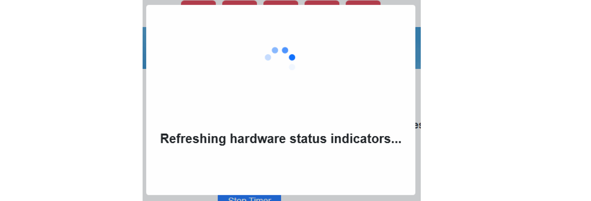
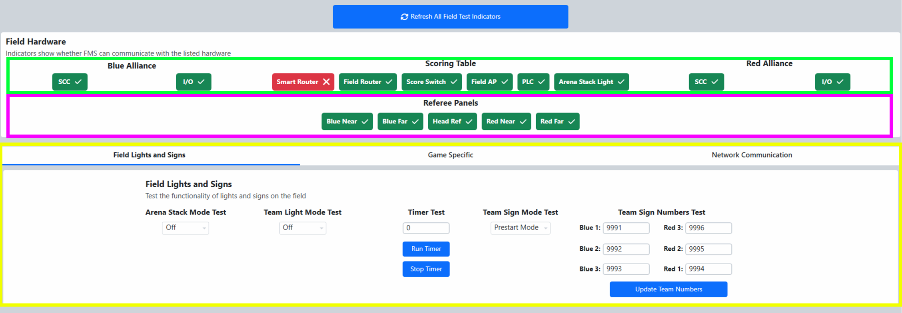
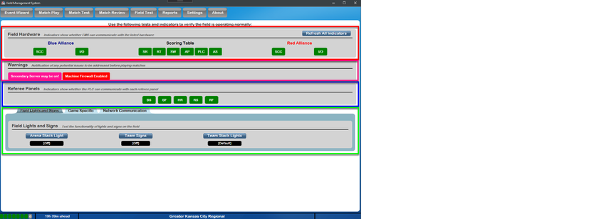

.. _field-test-field-test:

Field Test
===========

Field Test is used to confirm basic operation of all the LED Displays, Team Lights and scoring hardware.
Field Test can also be used to ping the web-based Audience Displays.
After Field Test a full Match Test should be used to confirm all hardware is performing as expected in-match.
In FMS Off-Season, the Field Test screen is not accessible.

On initial load, the screen will be temporarily blocked while the status of all hardware is updated.

Interface
#############################

[*Green Box*] Shows the connection status of the hardware at the corresponding areas of the playing field; Blue Alliance end, Scoring Table, and Red Alliance end. Green indicates
a successful connection. Use "Refresh All Field Test Indicators" to re-check the status. The indicators are:

* Blue Alliance - SCC, I/O
* Scoring Table - Smart Router, Field Router, Score Switch, Field AP, PLC, Arena Stack Light
* Red Alliance - SCC, I/O

Each indicator shows a check mark when FMS can communicate with that hardware and an X when it cannot. When an alliance end is configured to use the spare SCC, the SCC and I/O
indicators for that end are also satisfied by the spare SCC and spare I/O.

[*Red Box*] Warnings about system configuration, as detailed below.

[*Pink Box*] Communication status between FMS and each referee panel. A successful connection is shown in green. The indicators are Blue Near, Blue Far, Head Ref, Red Near and Red Far.
They are read when Field Test is opened, after the field has finished resetting. If the reset does not finish in time, FMS shows the warning "The field reset did not complete, so
the referee panel status could not be read." and the referee panel indicators are not filled in.

[*Yellow Box*] Shared hardware status area, detailed below

Lights and Signs
#############################

This panel is used to test the Stack Lights and team signs.

* Arena Stack Mode Test - tests each light in the stack at the Scoring Table. Choose Off, Red, Blue, Amber, Green or All.
* Team Light Mode Test - tests each light in the player station (the stack lights by the team signs, not any light strings in the station). Choose Off, a single station (Blue1 through Red3) or All.
* Timer Test - enter a time (in seconds) to manually run the timers on either end of the field

  * The time must be between 1 and 900 seconds (15 minutes)
  * "Run Timer" starts the countdown and switches the Team Sign Mode Test to Match Ready
  * "Stop Timer" stops the countdown and clears the time

* Team Sign Mode Test - tests the seven segment displays around the field. The modes are Test Mode, Night Mode, Awards Mode, Prestart Mode, Field Reset and Match Ready.

  * Awards Mode displays the season
  * Test Mode alternates between the station number and "8888"

* Team Sign Numbers Test - explicitly specify a team number to display on each team sign (Blue 1 through Red 3). "Update Team Numbers" sends the numbers to the signs and switches the signs to Prestart Mode.

.. note::
    The Team Stack Light test this will not illuminate the amber lights (E-stop indictor). E-stop lights only turn on when the E-stop in the corresponding Player Station is pushed, or the Arena E-stop is pressed

When you leave the Field Test tab, FMS resets the field and sets the Arena Stack Mode Test and Team Light Mode Test back to Off.

Game Specific Field Test
#############################

Please see the next page for additional information.

Ping Audience Displays
##################################

The "Ping Audience Displays" button, on the right of the Field Lights and Signs tab, sends a ping to the web-based Audience Displays. Each Audience Display that
is open and has sounds enabled plays a short sound, which confirms that the display is receiving messages from FMS.

Nothing changes on the Field Test screen when the button is pressed; FMS does not show a result or a list of the displays that responded. Check each display in person.

.. note::
  This *should not* be used as a sound test- use the audio test buttons within the Audience Display for sound tests.

Hardware Warnings
##############################

Any warnings detected during the hardware check will appear within the Field Test screen. The Warnings area is only shown when there is at least one warning. Hover over a warning to
see more detail. Possible warnings include:

* SCC Mismatch (Red) or SCC Mismatch (Blue) - That end of the field is configured to use the spare SCC, but the regular SCC for that end was found on the network.
* Arena E-Stop has been pressed - The Arena E-Stop has been pressed and the field has been disabled.
* Spare SCC found - A spare SCC was found on the network. Use Settings to verify the configuration.
* Spare I/O found - A spare I/O was found on the network. Use Settings to verify the configuration.
* Spare Lighting Controller found - A spare lighting controller was found on the network. Use Settings to verify the configuration.
* Access Point Wrong Port - The access point is plugged into the wrong port.

If the Score Switch cannot be checked, FMS shows "Unable to ping the Score Switch" or "Network Service Timed Out for Score Switch" when the indicators are refreshed.
