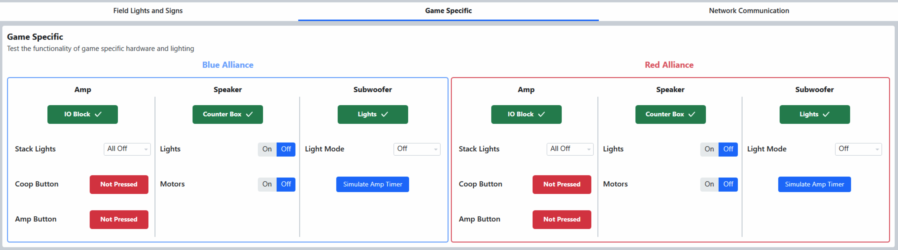

.. _field-test-game-specific:

Game Specific
======================

Field Test - Game Specific
##########################

The Game Specific tab is used to test the hardware and lighting of the current season's field elements. The elements and the names of the controls change each season,
but the tab has the same layout for each alliance, with the Blue Alliance on the left and the Red Alliance on the right:

* A connection status block, which will be green or red to indicate whether the alliance's game specific hardware can be detected by FMS.
* A row of numbered sensor blocks, which change color and text as each sensor in the field element is triggered. Trigger each sensor on the field and confirm that its block changes.
* A light mode dropdown, which can be used to turn the lights of the field element off or on, light individual sections, or run a preset pattern.
* Start and Stop buttons for each set of motors in the field element.

Clicking a Start button asks for confirmation before the motor runs. Ensure no one has their hands in or near the field element, and communicate to everyone on the field that the motor is starting,
then choose "Start Motor" to continue. The Stop buttons stop the motors immediately, without a confirmation.
