.. _match-play:

Match Play
===========

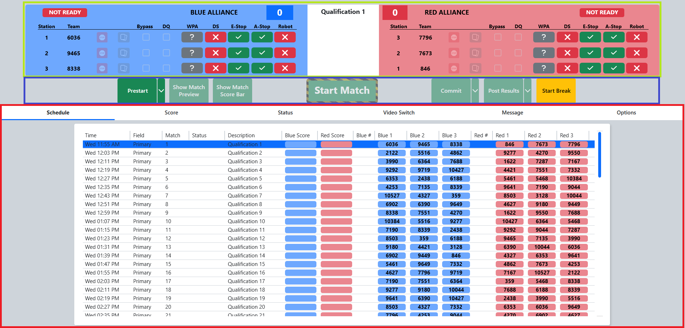

Match Play (and :doc:`Match Test <match-test>`) are the most commonly used environments during an FRC event. The screen is used to start and stop matches, disable robots, and control the Audience Display.

[*Green Box*] The top part of the screen shows the current match number, match time, score for the alliances and detail by station. The status of the robots at each end of the playing field is communicated to FMS by the SCCs and DSs. 
The color of each box corresponds to each end of the playing field, blue for the Blue Alliance, and red for the Red Alliance. 
Each box includes information on the status of the three robots on each alliance.

[*Blue Box*] The match is stepped through its states using the buttons in the center of the Match Play and Match Test screens.

[*Red Box*] The lower portion of the screen changes based on the selected tab to display schedule information, detailed scoring, and more (each tab has its own article)

Robot Status
--------------

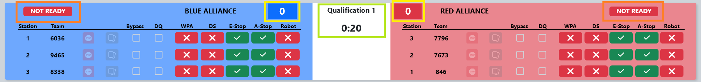

Match score (yellow boxes) and timing information in the center of the display (green box), with time represented in minute:seconds to match the timers on the field. 
The match number is also displayed, and additional conditional indicators will appear below the timer as applicable (such as when a referee review is underway). 
The status indicator on the "Blue Alliance" and "Red Alliance" sides (indicated by the orange box) will turn from Red to Green when there is a known ready state for all Robots on that Alliance (connected or bypassed). 
In order for a match to start, both backgrounds must be green (known state for all Robots on the Field).

The conditional indicators below the timer are:

* *SCORE READY* (green) - the field has reported that the score for the match is ready
* *REF DONE* (green) - the Referees have submitted their scores. Until this indicator appears, the Commit button is shown in the alternate (yellow) style and FMS asks for confirmation before committing (see the :ref:`Score Tab <match-play-score>`)
* *REF REVIEW* (yellow) - the match has been flagged for referee review. The flag can be removed again while the match is running; once the match has ended the indicator stays on screen until the next Prestart, and the review is recorded with the match when it is committed

*SCORE READY* and *REF DONE* are cleared at the next Prestart. In the Off-Season version of the software there are no Referee panels, so FMS shows both indicators by itself as soon as the match ends.

The top bar of Match Play also contains detailed station information- the background color indicates the alliance (Red or Blue) and meanings are detailed below.

The fields left to right indicate information about the connection state of each Driver Station, Robot and Team.

**Station** - Assigned station for corresponding team (Stations are 1, 2 and 3 from left to right when viewed from within the Alliance Station)

**Team** - The team number which corresponds with the team designated to play in this station. Teams need to be in the correct station to ensure that they receive the proper Station ID and Position information from FMS.

**Stop Button** - used to Estop the robot during the match. The button is only available while the match is running, and is disabled for a station that is already E-Stopped

**Card State/Button** (entered by Head Referee, can only be edited after Match is over by toggling throgh possible states):
   * Grey - no card, team in good standing
   * Yellow - team has been assigned a yellow card
   * Red - team assigned a red card in this match. Setting the indicator to red also bypasses the Player Station and automatically assigns the team a DQ for the current match. Note that in a subsequent match FMS will automatically change the red card to yellow

   The button can only be clicked between the end of the match and Commit. In Playoff matches a card applies to the whole alliance, so changing the card on one station changes it on all three stations of that alliance.

**Byp** - Select to bypass this particular station and force it to a ready (but disabled) state. The checkbox is available from the time Prestart completes until the match starts. (Note: The CTRL-SHIFT-B key combination will bypass every station that has no team assigned to it, which is shown as "Test" and a number in the Team column. It works after Prestart has completed and before all stations are ready, and it does not bypass a station that has a team assigned, even if that team is not connected.)

**DQ** - Select to indicate that the corresponding team has been DQ’d for this match (will also cause Bypass). The checkbox is available from the time Prestart completes until the match starts. In Playoff matches only the Station 2 checkbox is available.

**WPA Key status**
   * Grey with ? - no WPA key status is available for this station
   * Red with X - team has not been on the playing field
   * Yellow with Check - has linked with the field, but has not played in a match
   * Green with Check - the team has played in a match on the field

**DS Status**
   * Red with X - Driver Station is not detected by the playing field (FMS-to-DS link is down)
   * Green with Check - Driver Station is detected by the field

**E-Stop Status**
   * Red with X - The station has been E-Stopped. The indicator stays red after the button is released, until the Stop is cleared by a new Prestart
   * Green with Check - The station has not been E-Stopped

**A-Stop Status**
   * Yellow with X - The A-Stop is pressed
   * Green with Check - The A-Stop is not pressed

**Robot Status**
   * Red with X - Robot is not connected to the Driver Station
   * Green with Check - Robot is connected to the Driver Station
   * B - shown in place of the X or Check when the station is bypassed

.. note::
   The amber light in each Player Station window indicate the Stop status of the corresponding team. A solid amber light means the Robot has been E-Stopped (regardless of who intiated the E-Stop) and a flashing amber light indicates a A-Stop (initated by the team, which will automatically clear upon entering the Teleoperated period)

.. warning::
   All E-Stops and A-Stops need to be in the up (released) position to prestart or begin a match. Prestarting a match with any Stop down will prompt a dialog box to be shown indicated in which Player Station the Stop(s) are down.

.. _match-play-bypass-dq-red-card:

Bypass vs DQ vs Red Card
------------------------

Bypass and DQ essentially perform the same function to the Driver's Station, but have different outcomes with respect to event Rankings.

The bypass checkbox is selected when a team is unable to compete due to a malfunctioning robot, but still chooses to participate in 
the match by standing in the Alliance Station or utilizing a Human Player.  For this participation, the team is awarded full ranking 
points. Bypass disables any inputs from the corresponding team's Driver Station and cause the Team Light to flash at a 1Hz rate.

The DQ checkbox is used to disqualify a team from a match. A DQ is given to a team which plays a qualification match without having passed Inspection, or simply chooses not to participate in the match.

The referee will issue a Red Card for a number of reasons, such as rules violations or inappropriate conduct during a match.
If the Red Card indicator is showing when "Commit Score" is pressed the team receives 0 (zero) ranking points for that match (or, in a Playoff match, their alliance loses).

Match State
---------------------

The buttons in the middle section are used to step through the Match process. In order to be available for use, a match must be selected from the Schedule tab.

* *Prestart* - prepares the field for the upcoming match by configuring the field hardware for the upcoming match
   
   *Once Prestart begins, this button becomes "Prestart Cancel." Pressing it while Prestart is running cancels it immediately. Pressing it after Prestart has completed backs the field out to the pre-Prestart state, and asks for confirmation first. This is the "Back Out" referred to elsewhere in this article.*

   *In Match Test/Practice/Playoff matches, clicking Prestart will allow for entry of team numbers (in playoff matches this is also used to move teams between stations)*

* *Show Match Preview* - display the Match Preview screen on the Audience Display(s) with team names and current ranking data for teams in the upcoming match
* *Show Match Score Bar* - display the real-time-score screen on the Audience Display(s)
* *Match Start* - starts the Match

  *  *Match Cancel* - cancels a match in progress (button text changes after start)
  * *Discard Match* - discard the match result and logs (button text changes after match ends)

.. warning::
   MUST ONLY BE USED WHEN THE FIELD IS IN A SAFE STATE AND NO HUMANS ARE IN DANGEROUS POSITIONS. FTA MUST GIVE PERMISSION FOR A MATCH TO START!

* *Commit* - confirm the score of the match and write the details to the database
* *Post Results* - display the final score and results on the Audience Display(s) and publish the results to the web (when applicable)

* *Start Break* - start or stop a timeout and update the Audience Display(s) with the timing data. Also updates the on field LED displays. Timeout duration can be changed on the "Options" tab.

Abort Match Option
------------------

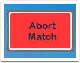

| 
| Once a match has started, the "Start Match" option becomes "Abort Match" as shown, which requires confirmation before ending a Match in progress.
   In non-emergency situations, the "Abort" option is preferred to the field E-Stop, as the E-Stop will put all Robots in an emergency shutdown state, whereas the "Abort" option will not.

If the Arena E-Stop is pressed while a match is running, FMS aborts the match immediately, without asking for confirmation. The match is then handled in the same way as one aborted from this button, and in Match Play it is shown as "Aborted" on the :ref:`Schedule Tab <match-play-schedule>`.

Discard Match Option
---------------------

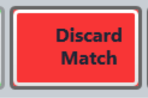

| 
| Once a match has ended, the "Abort Match" option becomes "Discard Match" as shown, which requires :ref:`HQ approval <hq-approval>` to use.
   The purpose of this option is to discard results and logs that will be declared invalid regardless, and thus bypass the need to commit and/or post the result (and risk it showing on the web).

Prestart Dropdown
-----------------

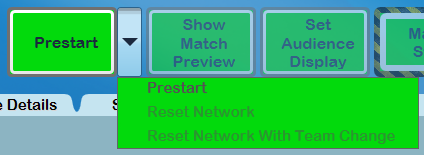

| 
| The Prestart button has additional options available via a dropdown.

* *Prestart* - the "typical" Prestart process, as outlined in the previous section
* *Prestart with last settings* - repeats the previous Prestart without re-programming the field network hardware, which is much faster. Only available when nothing has changed since that Prestart (same match and same teams in the same stations), such as after a "Back Out." It is always available in Match Test and in :ref:`Practice Field Mode <match-play-practice-field-mode>`.
* *Reset Network* - allows for re-programming of the field network hardware without a full "Prestart"
* *Reset Network With Team Change* - allows for re-programming of the field network hardware while also changing a team in one or more stations (disabled when not applicable, such as qualification matches)

.. note::
   The reset network option will not clear locked E-Stop and A-Stop states, instead a full "Back Out" and "Re-Prestart" is required to clear Stop flags.

Prestart Dropdown in Match Test/Practice
----------------------------------------

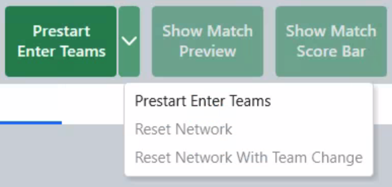

| 
| In some phases of the event, the Prestart button replaces "Prestart" with "Prestart Enter Teams." This happens in phases where FMS needs to know which teams are participating and in which positions, whereas in tradiitonal 
   qualification matches teams cannot swap stations so no option is presented to adjust team numbers or positions. Clicking in one of the station boxes will present a list of participating teams to select from, or the 
   team number can be entered using the keyboard. The team must be attending the event and have a generated WPA key in order to be available for Prestart.

* All other options work as described previously. Selecting Prestart Enter Teams will prompt for team numbers to participate in the match, as shown below. If teams were scheduled for the Match, they would be pre-populated in the display.

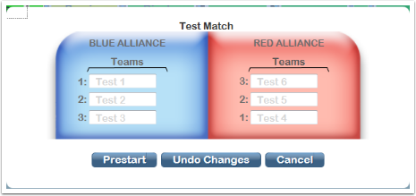

Prestart Messages
-----------------

FMS checks that the match can be run when Prestart is selected. If a check fails, one of the messages below is shown. Unless noted otherwise, the Prestart does not go ahead and must be selected again once the cause has been resolved.

The field device, SCC cabling and Playoff round checks are made by a regular Prestart. They are not repeated by "Prestart with last settings" or "Reset Network."

**Field devices** - FMS confirms that it can reach the field hardware it needs. If it cannot, a warning reading "Unable to prestart due to the following issues. Please resolve the issues and try prestarting again." lists one or more of:

   * "Field router not configured." - no "Router Type" has been set for the Field Router. See :ref:`FMS Network <settings-fms-network>`
   * "Unable to connect to Arena Stack Light." - FMS could not reach the Arena Stack Light on the field network
   * "Unable to connect to Robot Access Point." - FMS could not reach the Robot Access Point on the field network

   Ask the FTA to resolve the listed items before trying again. This check is not made in the Off-Season version of the software.

**SCC Cabling Swapped** - a dialog reading "Red and Blue SCC cabling is swapped. Driver stations will not connect to robots. Continue with prestart?" This is a warning rather than a block: "No" stops the Prestart so that the FTA can correct the cabling, and "Yes" continues the Prestart anyway. This check is not made in the Off-Season version of the software.

**Playoff rounds** - in Playoff matches on the Match Play tab, FMS will not Prestart a match that is out of sequence in the bracket. The warning begins "You cannot Pre-start this Match because" and ends with the reason:

   * "one or both of the alliances has not yet been determined." - the schedule does not yet have an alliance on both sides of this match
   * "the previous Playoff Round has not yet been completed." - the earlier round must be completed before a match from a later round can be played
   * "the subsequent Playoff Round has already begun." or "the subsequent Playoff Round is already completed." - a match cannot be replayed once the round that follows it has started
   * "its Blue alliance could not be determined." or "its Red alliance could not be determined." - FMS could not find the alliance assigned to that side of the match

**BYE match** - when the match includes a BYE alliance, a dialog titled "BYE Match - Choose Action" offers to advance the other alliance without playing the match. See :ref:`Non-Standard Playoffs <scorekeeper-non-standard-playoffs>`.

**Arena E-Stop** - if the Arena E-Stop is active when Prestart finishes its last step, the Prestart is cancelled with the warning "Arena E-Stop was pressed!" and the match returns to its state before Prestart. Make sure the Arena E-Stop has been released, then Prestart again.

Commit Dropdown
---------------

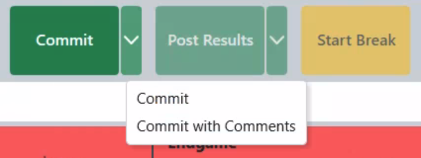

| 
| The Commit button has additional options available via a dropdown.

* *Commit* - traditional path of committing scores as final
* *Commit with Comments* - allows for entering a comment before the scores are committed

At official events, if the scores were edited by the Scorekeeper after the match a comment will be required regardless of selection.
A comment is also required if any team was assigned a card. If required or requested, a box will appear during the commit process.
Select from the template buttons as a starting point for comments or type freely in the provided box.

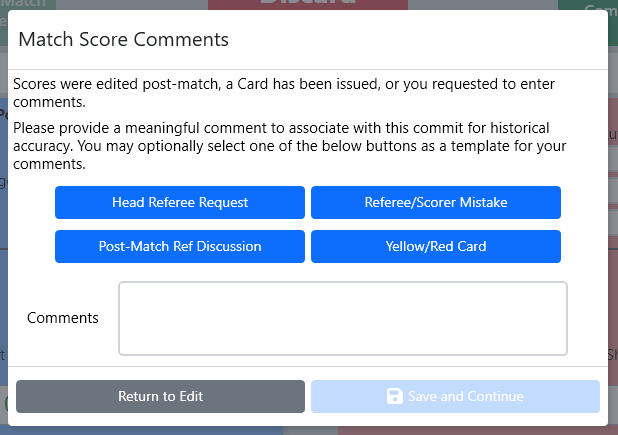

Post-Results Dropdown
---------------------

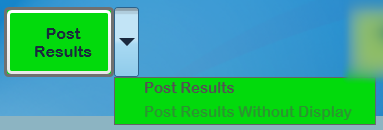

| 
| The Post-Results button has additional options available via a dropdown.

* *Post Results* - traditional path of posting results from the Match to the Audience Display
* *Post Results Without Display -* allows for posting of results from the Match without changing the Audience Display

Break Start
----------------

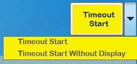

| 
| The Break Start button has additional options that present in a modal on click.

* *Break Time* - pick a default length or enter a custom length for the break (min:sec)
* *Enable Audio Warning* - (unchecked by default) when checked, audible queues will be emitted from the Audience Display as time expires
* *Match After Break* - indicate which Match # will be played after the break (for display to the Audience)
* *Show on Audience Display* - (unchecked by default) when checked, the Audience Display will reveal the timer when the Break is started

Alternate Flow
--------------

Some buttons have "alternate flows". Above are examples are alternate flows for "Show Match Preview," clicking an alternate (yellow) button will return to that step. 
Also shown is the style for Match Start, which has additional highlighting and padding due to the dangerous nature of enabling robots and starting a Match.

.. toctree::
   :maxdepth: 1
   :hidden:

   schedule-tab
   score-tab
   status-tab
   video-switch-tab
   message-tab
   options-tab

