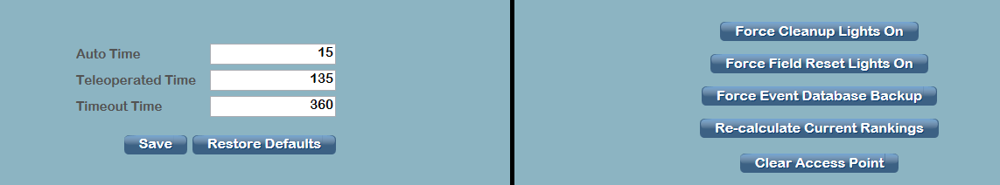

.. _match-play-options:

Options Tab
============

Match timing can be adjusted from this screen, for use in such things as demo matches. Clicking *Restore Defaults* will return Auto Time, Teleoperated Time and Default Break Time to their season-specific standards; the two Scoring Delay fields are not changed.
Select *save* after any adjustments for the timing to take effect. Timing can only be changed prior to Prestart.

* *Timing Items* - Adjust the corresponding time
* *Hide/Unhide Scores Automatically in Playoffs* - When enabled, the red and blue alliance total scores at the top of the Match Play screen are hidden when a Playoff match ends and shown again when the next match is started, so that a result cannot be read from the FMS screen before it is announced
* *Hide Scores* - Hide and unhide the red and blue alliance total scores at the top of the Match Play screen on demand. The scores stay hidden until the option is turned off again, or until the next Playoff match is started if the option above is enabled
* *Practice Field Mode* - Commits matches without scores, for fields where the score does not matter. Requires :ref:`HQ approval <hq-approval>` to enable. See :ref:`Practice Field Mode <match-play-practice-field-mode>`.

.. note::
   Both Hide Scores options affect only the two alliance totals on the Match Play screen. They do not hide or change anything on the Audience Display.

On the right side of the display there are options for some common operations:

* *Force Purple Lights On [CLEAn]* - When not in-match, force the purple "cleanup" lights to illuminate and indicate field staff may begin clearing the field. Not available in the Off-Season version of the software.
* *Force Green Lights On [SAFE]* - When not in-match, force the green field reset lights to illuminate and indicate to teams and field staff that the field is "safe to enter". Not available in the Off-Season version of the software.
* *Awards Mode* - Change the state of lights and motors on the field into a photogenic mode worthy of the awards ceremony. Not available in the Off-Season version of the software.
* *Force Event Database Backup* - Force a copy of the event database to be made and written to the USB Drive specified in :doc:`Settings <../settings/backup-config>`
* *Recalculate Qual/Playoff Rankings* - Runs all teams through the calculator for the given tournament level
* *Recalculate District Rankings* - Runs all teams through the calculator for the distirct rankings at the selected event. Only enabled at District events and District Championships
* *Recalculate Regional Advancement Rankings* - Recalculates the regional points of every team at the event and shows "Recalculation Completed" when it has finished. Only enabled at Regional events. It does not determine or publish which teams advance; that is done on the :ref:`Regional Advancement <event-wizard-regional-advancement>` step of the Event Wizard
* *Clear Access Point* - Remove the team number programming from the AP (does not change the 2.4 GHz radio). Useful in situations where a team needs to connect to their machine, but the AP is currently programmed to their team number (such as between finals matches)
