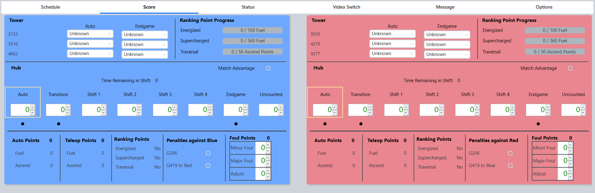
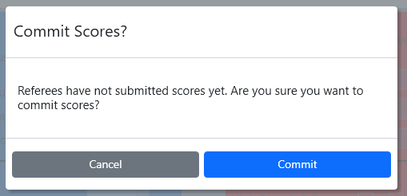

.. _match-play-score:

Score Tab
===========

Game specific field scoring and adjustments.

The Score Tab is the primary location used to confirm the score of the match prior to Commit Score. The information shown on this tab is input by the Referees using the Touchscreens or by the automated scoring system (except in FMS Off-Season). Scoring value can be manually edited through this interface. The total alliance score is automatically recalculated as these adjustments are made. Values are not editable until after the match is over, because values come from the Referees or automation during the match. In FMS Off-Season, values are editable during the match as there are no Referee panels or real time automation.

.. note::
    Be careful if you elect to manually score, or edit scores, using the score tab. There's no edit log until after the first time the score is committed.

At official *FIRST* events, all of the data on the score tab comes from automated hardware or certified Referees. The scorekeeper should not edit any values without the supervision and direction of the Head Referee.

All input values are quantities, not points. It is not necesary for the Scorekeeper to know the underlying score calculations as FMS will automatically convert any quantity inputs to point values.  
For additional information about each scoring element please see the official game manual or consult your Head Referee at your event. Values in the "Ranking Point Progress" section are read-only 
progression indicators relative to the associated ranking point.

.. warning::
    Notice that Major and Minor Foul Pts are points credited to the alliance, which means they're calculated off the other alliance's violations. Changing the Major/Minor Foul counts on a given 
    alliance will change the score of the *opposite* alliance.

Referee Completion Warning
--------------------------

| 
| If a Scorekeeper attempts to Commit a score before the Referees have completed their scoring of the match, a warning dialog will be presented.

Score Validation
----------------

When Commit is selected, FMS validates the values on the Score tab. If any problems are found, a warning is shown that begins "Scores failed validation:", lists each problem, and ends "Errors must be corrected before scores can be committed." The match is not committed.

Correct the listed values on the Score tab, under the direction of the Head Referee, and select Commit again. The checks are specific to each season's game, so the problems that can be listed change from season to season. Scores are not validated while :ref:`Practice Field Mode <match-play-practice-field-mode>` is enabled.

Select Winning Alliance
-----------------------

In rare cases FMS cannot decide the winner of a match from the scores and cards alone. When that happens, a "Select Winning Alliance" dialog is shown during Commit. It reads "The system was unable to determine a match winner for the following reason:" followed by the reason, and "Please confer with the Head Referee and select the Alliance that should advance".

* *Blue Alliance* / *Red Alliance* - record that alliance as the winner and continue with the Commit
* *Return to Edit* - close the dialog without committing, so that the scores or cards can be corrected

This dialog is not shown simply because the scores are tied. A tied match is normally committed as a tie or, in Playoff matches, decided as described under "Playoff Tiebreakers" below.

Post-Match Comments
-------------------

.. image:: images/score-tab-2.png
    :align: center

|
| If a match is edited by the scorekeeper after the clock expires, or any cards were assigned in the match, a comment window is automatically opened when the match is committed.
    This box can be used for comments regarding why the score was edited after the match ended and these comments will be saved and available later, should a review be necessary.
    The box can also be manually requested using the dropdown arrow on the Commit button.

Playoff Tiebreakers
-------------------

In Playoff matches where tiebreakers apply, FMS works through the season's tiebreakers when the alliance scores are equal. After the match has been committed, one of two messages reports the outcome:

* "Tie Broken" - reads "A tie has been broken due to" followed by the tiebreaker that decided the match. The alliance favored by that tiebreaker is recorded as the winner
* "True Tie!" - none of the tiebreakers separated the alliances. The match is committed without a winner; confer with the Head Referee on how the tie is to be resolved

The tiebreakers themselves are defined by each season's game manual.

