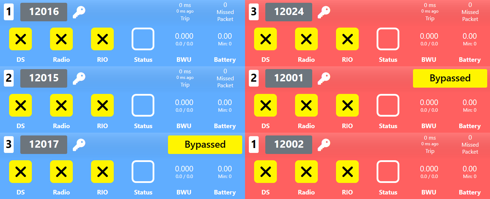

.. _match-play-status:

Status Tab
===========

The Status tab shows detailed information for each robot linked to FMS; this information is also displayed on the Field Monitor used by the FTA and FTA Assistant (FTAA).
The same data is collected for all stations.

.. note::
   This section only covers high-level information, as the display is covered in full detail in the :doc:`Web Field Monitor <../../field-monitor/live/live-monitor>` section.

The tab shows six tiles, one for each station. The Blue Alliance tiles are on the left, with Station 1 at the top and Station 3 at the bottom. The Red Alliance tiles are on the right, with Station 3 at the top and Station 1 at the bottom, matching the order of the stations at the top of the Match Play screen. Each tile is shaded in its alliance color.

Top of Each Tile
----------------

From left to right:

#. Station number
#. Team number
#. Key icon - shown until the team's WPA key has been used in a match
#. Walkie-talkie icon - shown when the robot radio connected in this station is not the radio saved for this team. It is not shown before or during Prestart
#. Trip - average time required to send a message to the robot and have the robot respond (this is basically a ping). Units are in milliseconds. The smaller figure beneath it ("ms ago") is the age of the most recent data from the robot radio
#. Missed Packet - the number of packets dropped in the DS-to-Robot link. Typically there are some lost packets

When the station is bypassed, a yellow "Bypassed" badge takes the place of the Trip and Missed Packet figures.

Bottom of Each Tile
-------------------

The lower part of the tile has six labelled readings:

**DS** - Driver Station
   * White circle with Check - the Driver Station computer is connected and the Driver Station software is running
   * Yellow square with ! - the Driver Station computer is connected, but the Driver Station software is not running
   * Yellow square with X - no Driver Station computer is connected

**Radio** - Status of the radio on the robot
   * Signal bars - the radio is connected and the Driver Station is communicating with the robot. More bars indicate a better connection
   * Laptop icon - the radio is connected to the field, but the Driver Station is not communicating with the robot
   * Yellow square with X - the radio is not connected

**RIO** - Status of the roboRIO on the robot
   * White circle with Check - the roboRIO is connected and robot code is running
   * Yellow square with ! - the roboRIO is connected, but no robot code is running
   * Yellow square with X - the roboRIO is not connected

**Status** - The state and mode of the robot
   * Empty outlined square - no match is running
   * White square with A or T - the robot is enabled in Autonomous (A) or Teleoperated (T)
   * Yellow square with A or T - the robot is disabled in Autonomous (A) or Teleoperated (T)
   * Yellow square with X - the state of the robot is not known
   * Black square with A - the station is A-Stopped
   * Black square with E - the station is E-Stopped

   The A-Stop and E-Stop states are shown whether or not a match is running.

**BWU** - Bandwidth Utilization/Consumption, in Mbps. The smaller figures beneath it are the transmit and receive rates (Tx / Rx)

**Battery** - Battery voltage reported by the Robot (12-13 is normally a fully charged battery, under ~9 may result in visible performance problems). A "Min:" figure is shown beneath it

Banners
-------

In two situations the lower part of the tile is replaced by a yellow banner:

* "MOVE TO" followed by a station (for example "MOVE TO BLUE 3") - the Driver Station connected in this station belongs to a team that is in this match but assigned to a different station. That team should move to the station shown
* "TEAM MISMATCH" - the Driver Station connected in this station does not belong to a team assigned to this match

The Trip and Missed Packet figures are also hidden while a banner is shown.
