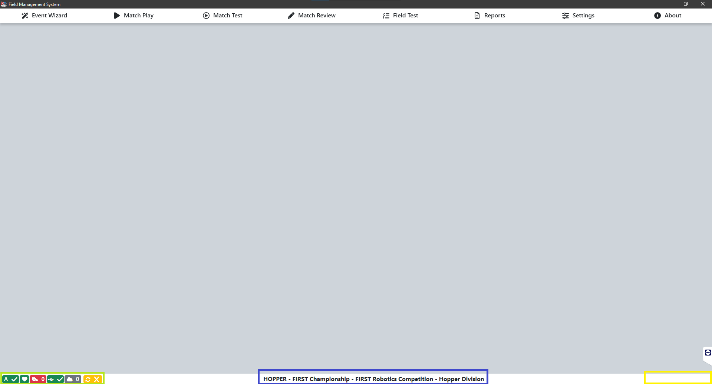
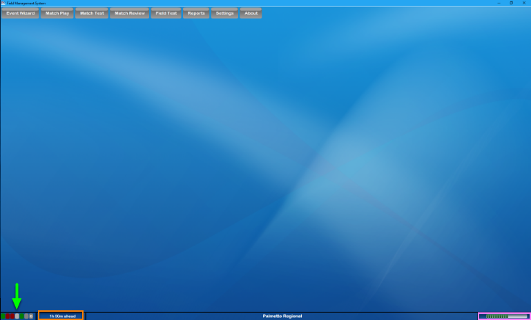
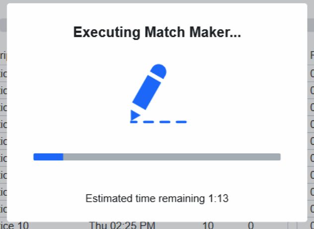

.. _navigation-indicators:

Indicators
======================

Indicators around the main window of Event Manager

Indicator Bar
--------------------

[*Green Box*] The bubble indicators relay quick status information about major hardware and software status information on the field. The bubbles are not displayed in the Off-Season version.

* "A" - Status of the Game-Specific Field Hardware and Red/Blue SCC (Field Automation)
* "Heart" - PLC Heartbeat and Arena Light Status (flashes at 1Hz)
* "Whistle" - Referee screen status (If red, the number of screens missing are displayed)
* "USB Symbol" - Backup Status
* "Cloud" - Sync Status (if red, number of outstanding tasks)
* "Checkmark" - Additional Sync status information

Most items have hover text with additional information. Generally, green means status is good, red means status is bad, and gray or yellow means requires attention.

[*Yellow Box*] The "ahead behind" timer displays once at least two matches have been played since FMS was opened. The time difference between when the match was started and when it was scheduled to begin will be displayed here. Hover over this timer to see recent cycle times.

.. note::
        As a general rule of thumb, events should not be operating more than one cycle time ahead of schedule. For example, if your cycle time is 7 minutes, then your "ahead behind" time should be "7 minutes ahead" or less.

[*Pink Box*] The event name and code are displayed at all times

Help
--------------------

The "Help" button (question mark icon) on the indicator bar opens this manual in the default web browser of the FMS server, at the page for the screen
currently on display. Pressing F1 anywhere in the Event Manager window does the same thing. FMS chooses the page from what is showing at the time:
the selected tab, the selected Event Wizard step, or the dialog that is open on top of them.

The manual is a website, so the server needs an internet connection for the page to load. If FMS cannot open a browser at all, an "Unable to open help" message
shows the address of the page so that it can be opened on another device, such as a phone.

Other Indicators
--------------------

As long as at least two matches have been run since opening FMS, hovering over the ahead/behind time in the bottom right corner will list recent cycle times as a quick preview.

When a task requires additional time to complete (such as schedule generation) a "busy indicator" will appear and block the screen until the operation completes

