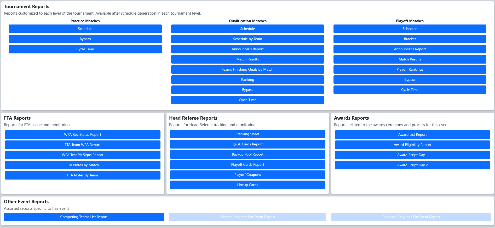
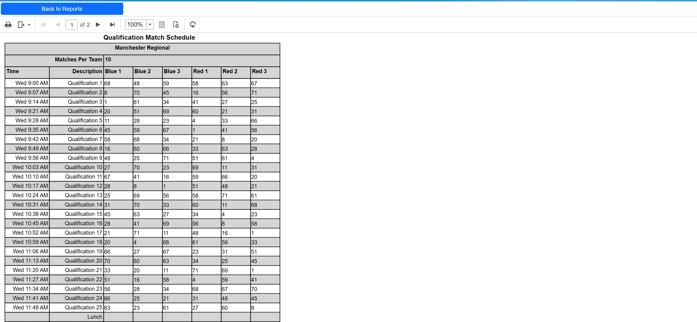

.. _reports-reports:

Reports
===========

Retrieve event information through formatted reports.

Menu
----

The Reports screen is used to generate printable reports needed throughout the tournament.
Printing options can be selected as well as a file-export options in Microsoft Excel, Word or PDF file formats.

Example Report
--------------

An example report, showing the qualification schedule for a demonstration regional. From here the report could be printed or saved using the buttons on the bar above the event title (in this example).

Available Reports
-----------------

Tournament Reports:

* Practice Matches

   * *Schedule* : Practice tournament match schedule (updated as teams are added or removed from matches)
   * *Bypass* : Shows which teams have been Bypassed during which matches of the practice tournament
   * *Cycle Time* : Shows the actual time between match starts

* Qualification Matches

   * *Schedule* : Qualification match schedule
   * *Schedule by Team* : Qualification match schedule, sorted by team (lengthy report, not recommended for printing)
   * *Announcer’s Report* : Detailed report of team details for reference by the announcers (one page per match)
   * *Match Results* : Final scores of all completed matches in the qualification tournament
   * *Teams Finishing Quals by Match* : Lists each qualification match that is the last scheduled qualification match for one or more teams, with the numbers of the teams that finish in that match. Useful for knowing when each team has played its final qualification match.
   * *Ranking* : Current qualification ranking of all teams at the event (updates as matches are played or re-played)
   * *Bypass* : Shows which teams have been Bypassed during which matches of the qualification tournament
   * *Cycle Time* : Shows the actual time between match starts

* Playoff Matches

   * *Schedule* : Playoff match schedule
   * *Bracket* : Tournament bracket
   * *Announcer’s Report* : Detailed report of team details for reference by the announcers (one page per alliance)
   * *Match Results* : Final scores of all completed matches in the playoff tournament
   * *Playoff Rankings* : Shows the playoff alliances in rank order within the current playoff level and with their ranking detail
   * *Bypass* : Shows which teams have been Bypassed during which matches of the playoff tournament
   * *Cycle Time* : Shows the actual time between match starts

FTA Reports:

* *WPA Key Status Report* : Shows if teams have linked or played in matches successfully
* *FTA Team WPA Report* : Same as *WPA Key Status Report* , but with WPA keys shown. Requires FTA password to run and should not be printed.
* *WPA Test Pit Signs Report* : Generates one page per team that has not yet connected to the field (to place in the team’s pit or distribute as reminder to come do a connection test)
* *FTA Notes By Match* : Notes recorded in the :ref:`FTA Notepad <fta-notepad-overview>` for each match that has been prestarted, covering Test, Practice, Qualification and Playoff matches with the most recent match first. Notes about the match itself are listed before the notes about each team in the match. Deleted and private notes are not included.
* *FTA Notes By Team* : Notes recorded in the FTA Notepad about each competing team, listed in team number order, with each team's notes in match order

Head Referee Reports:

* *Tracking Sheet:* Used by Head Referees for tracking information throughout the event. Head Referee may request a copy from the Scorekeeper.
* *Qual. Cards Report* : Match schedule showing teams with assigned cards during the qualification tournament
* *Backup Pool Report* : For tracking teams as they accept or decline their position as a backup robot in the playoff tournament
* *Playoff Cards Report* : Match schedule showing alliances with assigned cards during playoff matches
* *Playoff Coupons* : Backup robot coupons for the playoffs tournment
* *Lineup Cards* : Lineup submission sheets for use during the playoff tournament

Awards Reports:

* *Award List Report* : Lists awards to be given out at the event. The winners are included if they have been assigned.
* *Award Eligibility Report* : Lists all teams attending the event and their eligibility for certain awards (such as the Rookie All Star Award).
* *Award Script Day 1* : Script for the Announcer to read for awards expected to be presented on the first day of the event
* *Award Script Day 2* : Script for the Announcer to read for awards expected to be presented on the second day of the event

Other Event Reports:

* *Competing Teams List Report* : A complete list of the teams competing at the currently selected event
* *District Rankings For Event Report* : District rankings of eligible teams playing at the currently selected event. Not representative of overall district ranking, only position at the selected event. Only available when the active event is a District event or District Championship.
* *Regional Rankings For Event Report* : Regional rankings and points awarded at the currently selected event for every team. Only available when the active event is a Regional.
