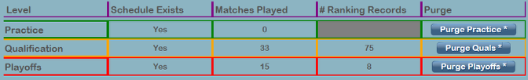
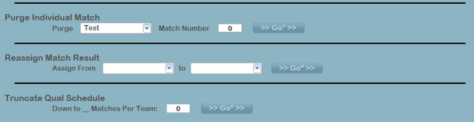
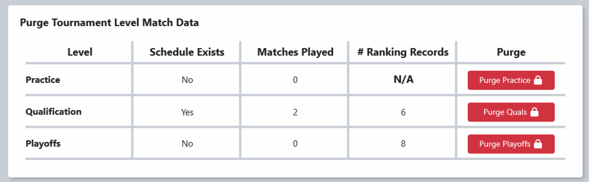
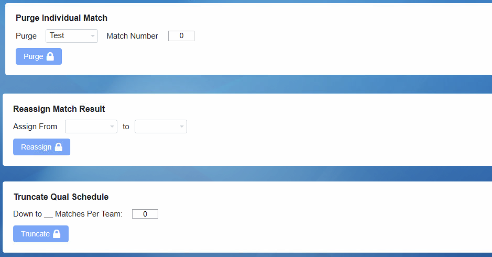

.. _settings-data:

Data
===========

Experimental data manipulation options, which should only be executed under the supervision of FRC Engineering.

District Rankings
-------------------

Force a recalculation of District Rankings.

[ *Recalculate Regional Advancement Rankings* ] Force a recalculation of the Regional Advancement rankings for the active event. The button
is beside the District Rankings button and is available only when the active event is a Regional. FMS asks "Are you sure you would like to
recalculate regional advancement rankings for the (event name) event?"; choose "Recalculate" to continue, and FMS shows "Recalculation Completed"
afterwards. It does not require HQ approval or a password. See :ref:`Regional Advancement <event-wizard-regional-advancement>` for how
the rankings are used.

Approval, Confirmation and Backup
---------------------------------

Every purge, reset, truncate and reassign action on this tab follows the same steps:

1. FMS asks for :ref:`HQ approval <hq-approval>`. If approval is not given, nothing is changed.
2. FMS asks for confirmation, naming the active event. Nothing is changed unless the confirmation is accepted ("Purge", "Reset",
   "Truncate" or "Reassign").
3. FMS takes a full backup of the event database, and then carries out the action.

"Reassign Match Result" always requires HQ approval, including after the competition season has ended.

The purge and reset buttons are unavailable when there is no active event.

Event Level
-----------

[ *Purge Event Data* ] Purge an entire event, all match and alliance data.

[ *Purge Alliances* ] Purge just the alliances from an event.

[ *Reset Participants* ] Undo any participants added manually, and return the registration list to its state as downloaded from HQ.

[ *Purge Award Assignments* ] Undo all award assignments, return the awards to their default (unassigned) state.

Tournament Level
----------------

[ *Level Column* ] The level being referenced by that data row.

[ *Schedule Exists Column* ] Yes/No of whether the schedule has been generated (schedule plus alliance pairings).

[ *Matches Played Column* ] Count of the number of matches played in that level.

[ *# Ranking Records Column* ] The number of Qualification ranking records that exist, or, for Playoffs, the number of alliance ranking records that exist.

[ *Purge Column* ] Purge the given level, such that all matches and logs are deleted. This cannot be undone.

Detail Level
------------

[ *Purge Individual Match* ] By selecting a tournament phase and entering a match number, dump only one specific match from a level (all plays lost).

[ *Reassign Match Result* ] By selecting a test match and traditional match, the results can be overwritten from the test match to the traditional match. The original 
results of the traditional match will be lost, and replacement is only done on the most recent play.

[ *Truncate Qual Schedule* ] By entering a value here, the qualification schedule can be shortened, while maintaining equality for all teams (this is only for emergency 
use, such as acts of god or the direction of *FIRST* HQ). It requires HQ approval. "Truncate" is available only while Qualification is the
active tournament level. The confirmation shows the total number of matches for the requested value and for the neighboring values as alternatives,
and the truncation cannot be reversed. Rankings must be recalculated manually afterwards.

