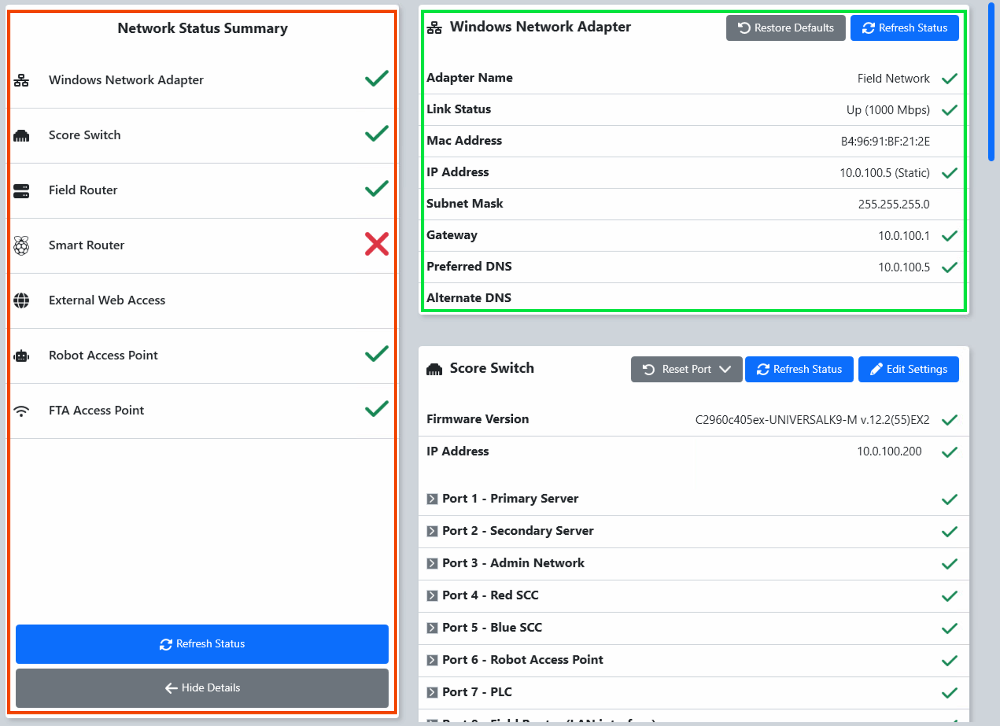
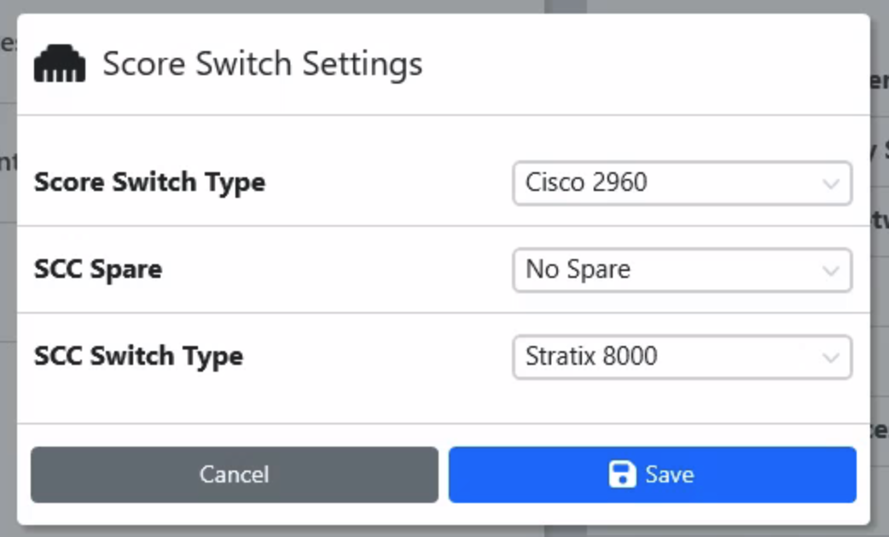
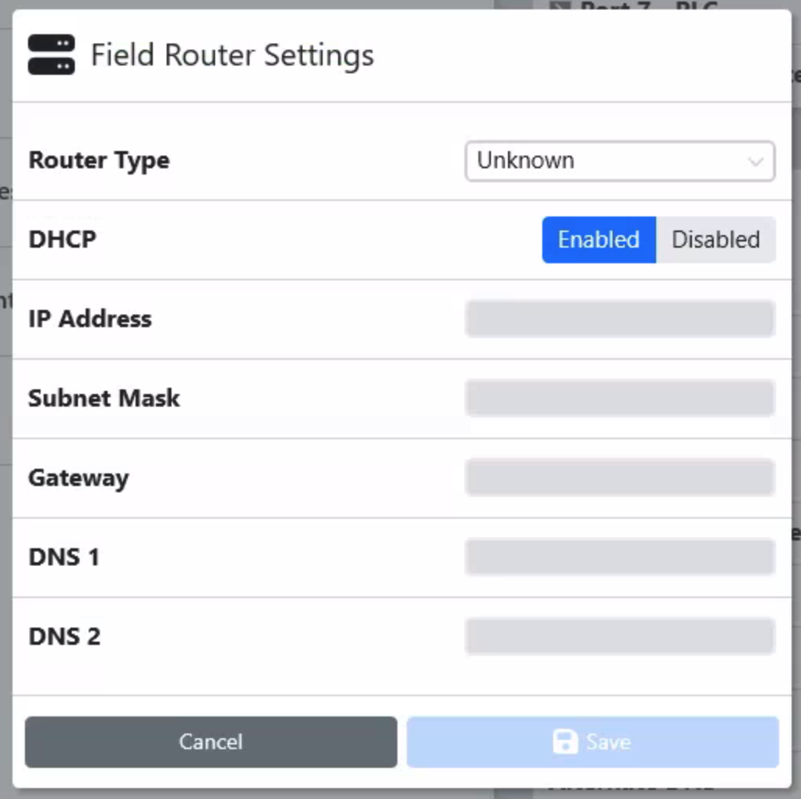
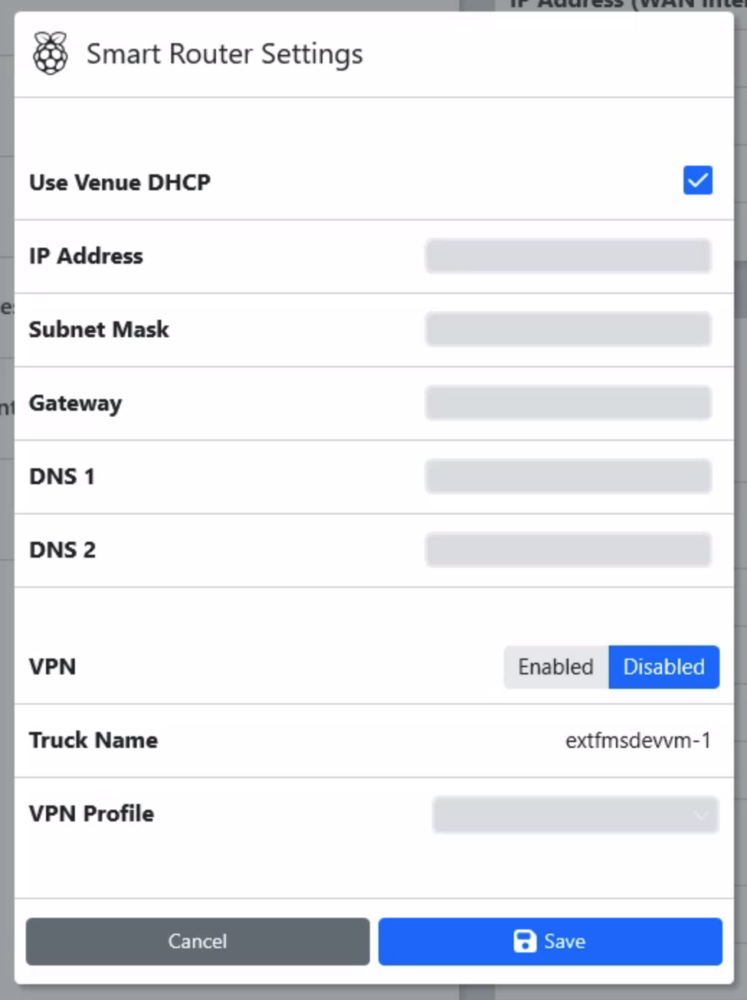
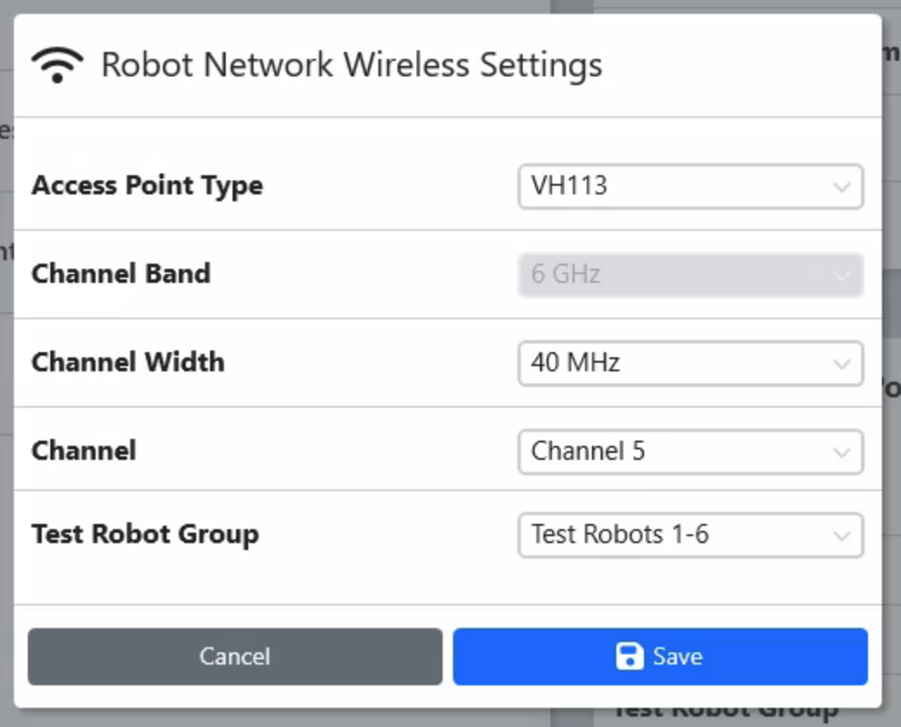
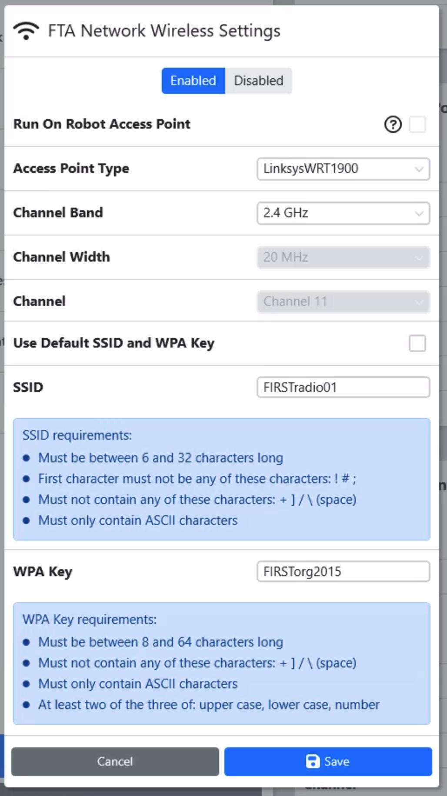

.. _settings-fms-network:

FMS Network
======================

The FMS Network tab on the Settings page contains all of the network status information that is 
queried from the FMS hardware and software. It has scrolling sections on the right for the components that 
are queried: Windows Network Adapter, Score Switch, Field Router, Smart Router, External Web Access, 
SCC Switch, Robot Access Point and FTA Access Point. The FMS Network tab is disabled in the Off-Season
version of the software.

[ *Red* - Overview] The components and their general status, the details of which can be viewed in the right side section

[ *Green* - Detail] Detailed information for each tracked component

Checking the Network Status
#################################

FMS does not check the network when the tab is opened. The indicators in the "Network Status Summary" list and
in the detail sections stay blank until a check is run.

[ *Refresh Status* ] The button at the bottom of the summary checks every component, one at a time. A component's
summary row shows a spinner while it is being checked, then a green check, an amber warning triangle or a red X. Each detail
section also has its own "Refresh Status" button that re-checks only that component; these are unavailable while a full
refresh is running.

[ *Cancel Refresh* ] Takes the place of "Refresh Status" while a full refresh is running, and stops it.

[ *Show Details* / *Hide Details* ] Shows or hides the detail sections on the right side. Clicking a row in the summary
also shows the details and scrolls to that component's section.

A full refresh skips components that cannot be reached because an earlier check did not pass. A skipped component stays blank:

* If the Windows Network Adapter link is down, nothing else is checked.
* The Field Router and Smart Router are checked only if the Score Switch port for the Field Router passes. External Web Access is
  then checked only if the Smart Router check passes or reports a warning.
* The SCC Switch is checked only if the Score Switch ports for the Red SCC and Blue SCC both pass.
* The Robot Access Point is checked only if the Score Switch port for the Robot Access Point passes.

When a check reports a problem, a red (error) or amber (warning) banner at the top of that component's section describes
the problem and lists "Suggested next steps:".

FMS Network Sections
#################################

[ *Windows Network Adapter* ]
FMS can only operate correctly, and communicate with Robots, when it's Windows adapter is properly configured. 
This check will verify the configuration and the "Restore Defaults" option can be used to correct any discrepancies.

[ *Score Switch* ]
Checks the status of each port on the managed switch inside the #33 road case. The "Edit Settings" option 
is used to specify the "Score Switch Type" in use on the field; saving a change to it requires
:ref:`HQ approval <hq-approval>`.

|
| The "Score Switch" and "SCC Switch" Types need not be adjusted without the direction of *FIRST* Engineering 
    as they are configured prior to the field being shipped. 

Below the switch details, the section has a row for each switch port, named for the device expected on it. Each row has its own status indicator.
Clicking the small arrow button at the start of a row expands it to show that port's link status, speed, duplex and VLAN;
only one row is expanded at a time. The "SCC Cabling" row above the ports shows the result of the SCC cabling check.

The "Reset Port" dropdown at the top of the section lists the same ports. Selecting a port resets it as soon as it is
clicked, with no confirmation and no password prompt, and FMS then re-checks the Score Switch.

.. warning::
    "Reset Port", and the "Reboot" buttons on the Field Router and Smart Router, act immediately and interrupt the field network.
    Do not use them without FTA and/or *FIRST* Engineering support.

[ *Field Router* ]
Checks the status and settings of the router inside the #33 road case. The "Edit Settings" option 
is used to specify the Router Type and DHCP settings for the incoming internet network. The "Router Type" 
need not be adjusted without the direction of *FIRST* Engineering as they are configured prior to the 
field being shipped. Saving a change to the "Router Type" requires HQ approval; the DHCP and address settings
can be saved without it.

|

.. warning::
    In almost every case the Field Router need not be adjusted, as the Smart Router would be updated to the venue-specific settings instead.

The "Reboot" button acts as soon as it is clicked, with no confirmation and no password prompt. FMS re-checks the Field Router
afterwards. See the warning under Score Switch before using it.

[ *Smart Router* ]
Checks the status of the Smart Router- the device that sits between the venue internet and the field network. This device is responsible for detecting 
the venue IP and providing an address in a non-colliding scheme to the Field Router. The "Edit Settings" option can be used to specify a venue 
configuration if a static IP is required. Smart Router should only be edited under the supervision of the FTA or *FIRST* Engineering.

|

The "Edit Settings" dialog also has a "VPN Profile" dropdown and a "VPN" enable/disable switch. The status section shows the current
values as "Profile" and, under "VPN", "Enabled" (Yes or No). Do not change either without the direction of *FIRST* Engineering.
What FMS asks for on "Save" depends on what was changed:

* Changing the "VPN" switch requires the FTA password.
* Changing the "VPN Profile" requires HQ approval.
* Changing only the IP and DNS settings requires neither.

When the "VPN" switch is changed, FMS shows "Updating VPN..." for about two minutes before the save finishes; this wait is expected.
When "Obtain IP settings automatically" or "Obtain DNS settings automatically" is changed, FMS reboots the Smart Router as part of the
save and shows "Rebooting Smart Router...".

After the save, FMS shows a "Field Router Configuration" prompt recommending that the DHCP configuration of the Field Router
also be confirmed. Choose "Configure" unless instructed otherwise by FRC Engineering.

The "Reboot" button acts as soon as it is clicked, with no confirmation and no password prompt. The section is cleared when the
reboot is requested; use "Refresh Status" to check the Smart Router again afterwards. See the warning under Score Switch before using it.

| [ *External Web Access* ]
    FMS uses several web based programs and services to support event operation. This check attempts to communicate with the most common 
    services and displays whether or not the attempt is successful. 

[ *SCC Switch* ]
Checks the status of the switches in the red and blue Station Control Cabinets (SCC). The "Edit Settings" option opens the
"SCC Switch Settings" dialog. In most cases, the only value that would need adjustment is the "SCC Spare" if a replacement cabinet
is being used on the red or blue field end ("No Spare", "Spare in Blue" or "Spare in Red").

The dialog also has "Blue Team Port 4", "Blue Team Port 5", "Red Team Port 4" and "Red Team Port 5". Each can be set to "Not In Use",
"Station 1", "Station 2" or "Station 3". "Save" is unavailable while both ports on the same alliance are set to the same station.
While any of these ports is assigned to a station, the SCC Switch check reports the warning "Spare SCC Ports are in use".

Saving any change in this dialog, including "SCC Spare", requires HQ approval.

[ *Robot Access Point* ]
Checks the status of the 6GHz Vivid Hosting radio used for Robot communication from Driver Stations. Clicking the "Edit Settings" button allows 
adjustment of the Access Point hardware in use as well as channel information. Under normal operation, FRC fields use the VH113 radio and 
Test Robots 1-6. The test group can be used to avoid overlaps of radio test groups when there are multiple FRC access points at the event. 
Do not change the settings on the Access Point without FTA and/or FRC Engineering support. "Edit Settings" requires HQ approval
before the dialog opens.

|

When the Robot Access Point is a VH113, the section also has a "Wifi Scan" button. It scans the Wifi environment,
and its results are used to choose the channel for the Robot Access Point.

.. warning::
    A Wifi scan disconnects all robots. FMS asks "When performing a Wifi environment scan all robots will be disconnected.
    Do you want to continue with the Wifi scan?" before it starts; choose "Continue" only when no robots need to be connected.
    Do not run a scan or change the channel without FTA and/or FRC Engineering support.

When the scan finishes, the "Wifi Scan Result" dialog opens:

* The top of the dialog shows the channel and channel width currently in use.
* "Export Results" saves the scan results to a text file.
* The table lists up to twelve channels for the selected "Channel Width", ranked with the highest "Availability" first and then
  the lowest "Load". The columns are "Rank", "Channel", "Availability" and "Load".
* To change channel, select a row in the table and click "Change Channel". "Change Channel" is unavailable until a row is selected.
  "Cancel" closes the dialog without changing anything.

Changing only the channel requires the FTA password. Changing the "Channel Width" requires HQ approval.

| [ *FTA Access Point* ]
    Checks the status of the 2.4/5GHz radio used for FTA/Field Staff operations on the field network. Clicking the "Edit Settings" button allows 
    adjustment of the Access Point hardware in use as well as channel information. Under normal operation, FRC fields use the Linksys 1900 radio on 2.4GHz.
    Saving changes in the "Edit Settings" dialog requires the FTA password. The WPA Key is not shown again once it has been saved: the "WPA Key" box is
    empty each time the dialog is opened, and leaving it empty keeps the current key.
    If the WPA Key is forgotten, a new one must be set by the FTA. Do not change the settings on the Access Point without FTA and/or FRC Engineering support.

|

The "Edit Settings" dialog has two further options:

* "Use Default SSID and WPA Key" applies the standard SSID and WPA Key for FRC fields. While it is checked, the "SSID" and "WPA Key"
  boxes cannot be edited. Uncheck it to enter custom values. The dialog lists the requirements for each, including the characters that
  are not allowed: the SSID "Must be between 6 and 32 characters long", and the WPA Key "Must be between 8 and 64 characters long"
  with "At least two of the three of: upper case, lower case, number". "Save" is unavailable while an entered value does not meet the requirements.
* "Run On Robot Access Point" cannot be selected when the Robot Access Point is a VH113, which is the radio used on FRC fields
  under normal operation. A help icon beside the option then reads "Robot Access Point does not support running the FTA Wireless Network".
