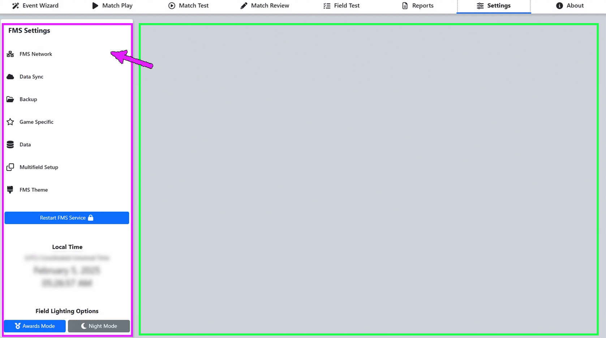

.. _settings-menu:

Settings Menu
======================

The Settings screen can be accessed from the Settings tab along the top of the window. This screen contains important global settings for network, hardware, backup, and data configurations within the FMS Software.
Some items within the Settings screen may be used by Scorekeepers and FTAs, such as Backup Configuration, some network settings, spare hardware configuration, and others.
However, some of the items require :ref:`HQ approval <hq-approval>` each time they are used. These items are deemed "Critical" (as in the case of AP channel
configuration or changing the Data Sync state) or "Experimental"  (as in the case of purging tournament data). There is no longer a Settings Lock to unlock for the whole screen; FMS asks for
approval when one of these items is selected. The Off-Season version of the software never asks for approval, though some features (such as hardware configuration or Data Sync) are disabled because they do not apply.

The left bar of the Settings Page (pink box) contains quick-access information and available tabs. Information also includes the current server time information and the currently active time zone.

.. important::
    It is critical that the time zone of the server be set correctly for the location the event is being held, especially if the event will have schedules and data available online. 

Clicking the tabs on the left will change which data is available on the right side of the screen (green box). Information about each tab can be found in its associated documentation step.

The bottom has buttons for a few operations:

[*Restart FMS Service*] Click to reset the underlying FMS Service on the Server, which requires the FTA password

[*Awards Mode*] Enable all LEDs on the field to match their alliance color and display the current year on the Team Signs

[*Night Mode*] Turn off all LED Displays and put the field in a low power state

.. _hq-approval:

HQ Approval
-----------

Some actions in FMS, on the Settings screen and elsewhere, require HQ approval before they are carried out. Where this
manual says an action requires HQ approval, FMS shows a *FIRST Engineering Restricted* dialog when the action is
selected.

At official events FMS sends the request to *FIRST* Engineering, and the dialog waits while they approve or deny it.
Contact your designated event support engineer so they know what is being requested and why. Once the request is
approved the action continues; if it is denied or the dialog is canceled, nothing is changed. The dialog also has a
*Use Password* option for a support engineer to enter a password instead. If requests to *FIRST* Engineering have not
been set up on the server, FMS asks for the password directly.

Approval covers only the one action that was requested. The next restricted action asks again.

Once the competition season has ended, many of these actions accept the FTA password instead of HQ approval. Actions
described in this manual as requiring the FTA password always use the FTA password and are never sent for HQ approval.

The Off-Season version of the software does not show either prompt. Actions that require HQ approval or the FTA
password at an official event proceed without one.
