.. _field-monitor-v3-live-simple:

Field Monitor
=============

The Field Monitor provides a live view of robot and field status. To view the Field Monitor, access the web interface at 10.0.100.5 and select Field Monitor from the navigation bar.  Use ctrl-b to swap the position of the red and blue field ends.  The Field Monitor is designed to run in full screen (F11); see :ref:`Screen size and layout <field-monitor-v3-screen-size>`.

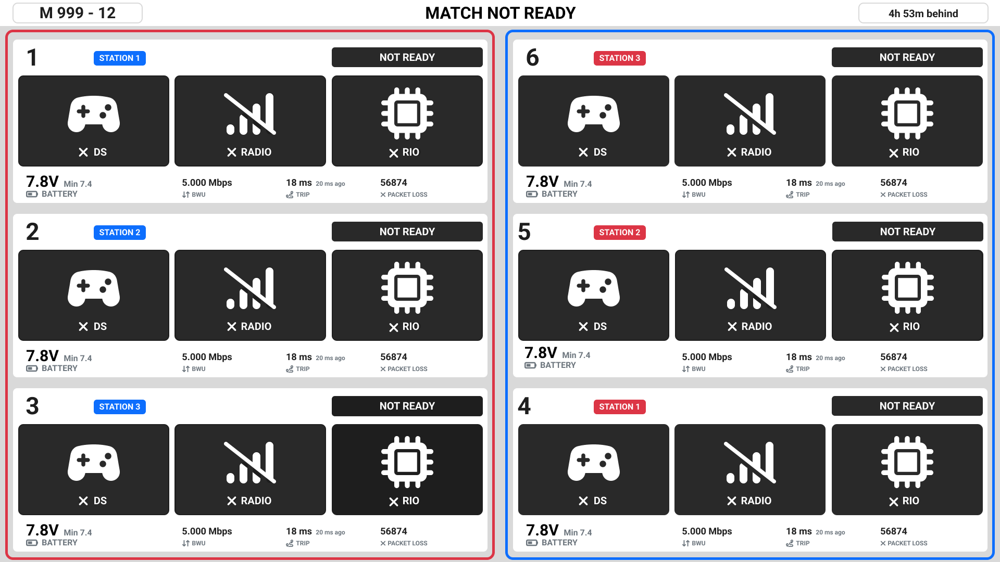

The Field Monitor shows match state and robot/driver station connectivity. The top row of the field monitor shows the match number and the match status.

Driver station pane
-------------------

Each of the six driver stations has a pane that shows status for that station.  In each pane, the first number indicates the station, 
and the second number indicates the team assigned to that station. In the example above, team #4 is assigned to the Red 3 station.

Four symbols show the connectivity state of the station.

======  ===========
Label   Description
======  ===========
DS      Driver Station connectivity.
Radio   Robot radio connectivity.
RIO     indicates whether the Driver Station is communicating with the roboRIO.
Robot   indicates the current state of the robot.
======  ===========

:ref:`Status Indicators <field-monitor-v3-status-indicators>` provides details on the meaning of the connectivity state symbols.

When a robot is fully connected, the statistics section populates with useful metrics about the robot and its connectivity to the field.

==============  ===========
Label           Description
==============  ===========
Trip Time       The round trip time taken by the control/status packets between the driver station and the roboRIO, in milliseconds.
BWU             Network bandwidth consumption between the driver station and robot, in megabits per second.
Missed Packets  Count of control packets that were not acknowledged by the roboRIO.
Battery         Current voltage and lowest voltage reported by the roboRIO.
==============  ===========

Prior to Prestart
-----------------

No valid robot data is shown prior to prestart. It is normal to see TEAM MISMATCH prior to prestart, as the comparison is being 
made to the teams from the previous match.

Pre-Start Complete
------------------

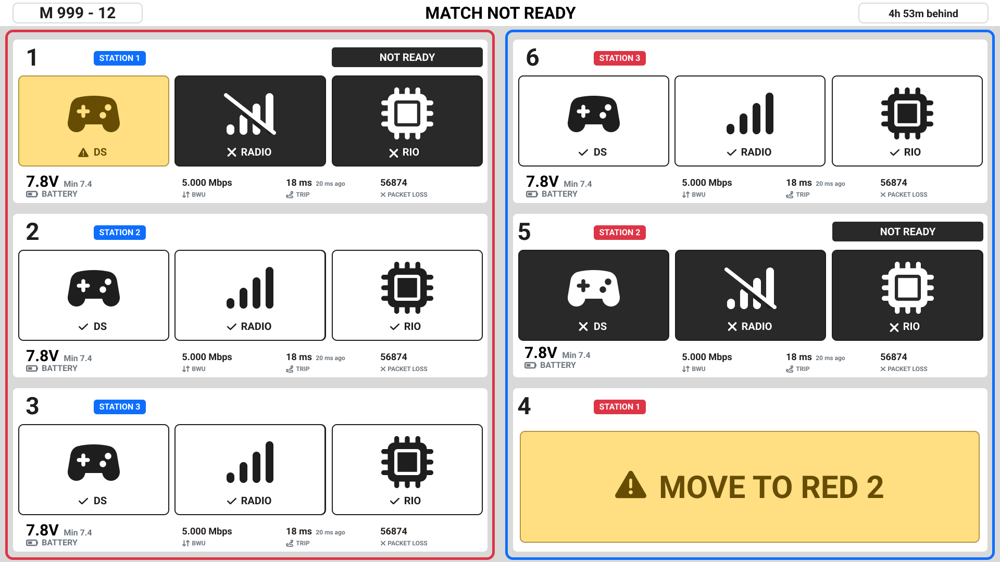

Once prestart is completed, valid data is shown on the monitor.

Team 1 has a computer connected in to the driver station, but the Driver Station software is not running.

Team 5 is connected to Team 4's Driver Station, indicated by the yellow bar "MOVE TO STATION 2". The team's driver station and the 
display on the back of the team sign will also indicate that they should move to a different station.

The team in Station 4 has a team number that is not in the match.  TEAM MISMATCH can also appear if the match has not been prestarted.

Match Ready
-----------

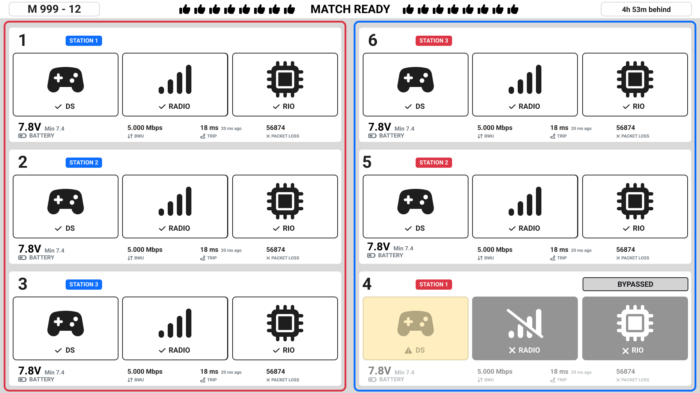

The match is ready to start. Team 4 is Bypassed (will not run in this match).

.. note::
  When a robot is bypassed, all of the status indicators will be greyed out (50% transparency) but will still update in real time if the robot or DS connect to the field.

Match Running
-------------

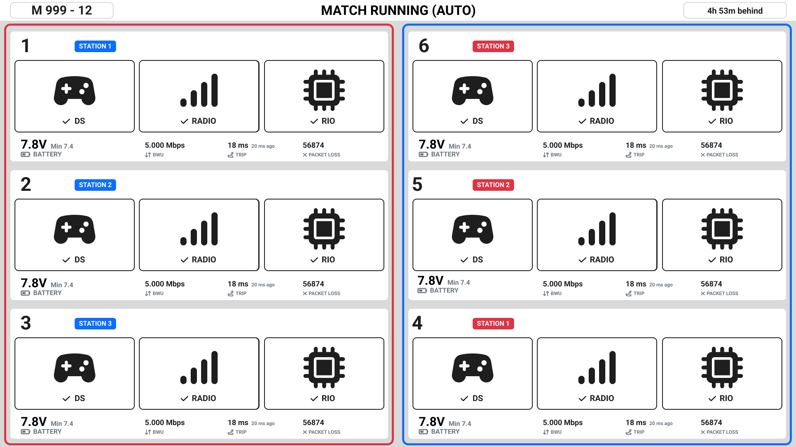

All robots are running in autonomous mode.

Match Running (E-Stop and Radio disconnect)
-------------------------------------------

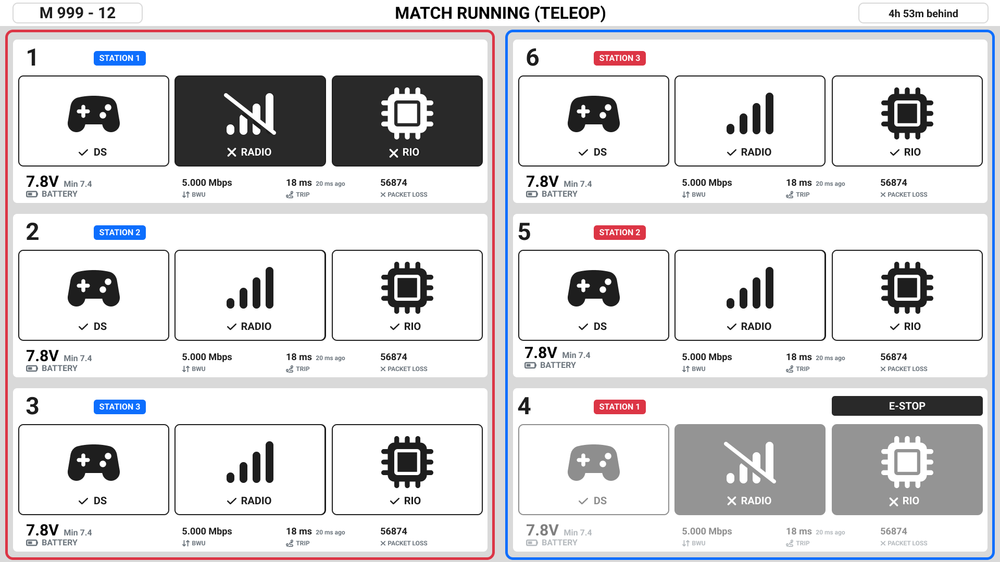

Robots are running in teleop mode. Team 4's robot has been e-stopped, either by the e-stop button in their station or by field staff. Team 1's radio is not connected to the field access point.

.. note::
  When a robot is E-Stopped, all of the status indicators will be greyed out (50% transparency) but will still update in real time if the robot or DS connect to the field.

Match Aborted
-------------

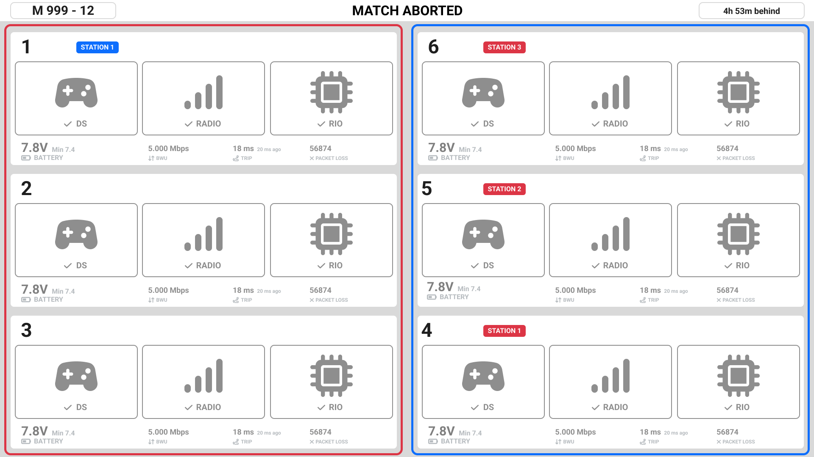

Indicates that a running match was stopped by field personnel.  It will return to "Ready for Prestart" promptly. All stations become greyed out after a match ends or is aborted until the next match is pre-started.

Match Over
----------

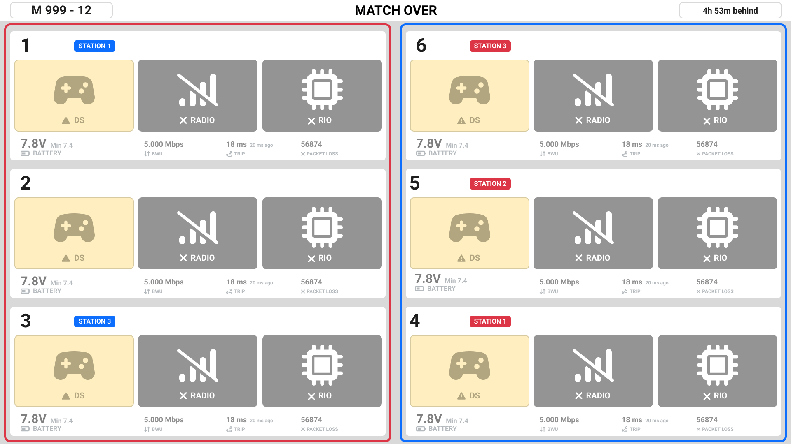

The match ran to completion successfully. Robot radios are no longer connected.  Driver station laptops are connected but there is 
no longer communication with the driver station softare. All stations become greyed out after a match ends or is aborted until the next match is pre-started.

Special indicators
------------------

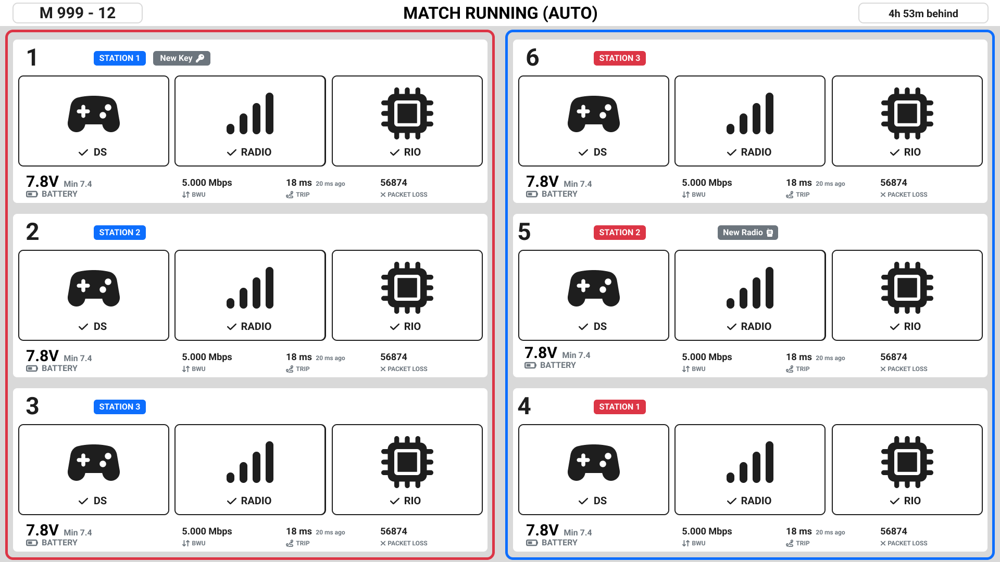

In blue station 1, the grey badge that says "New Key" indicates that the team has not yet participated in a match.

In red station 2, the grey badge that says "New Radio" indicates that the robot radio's MAC address is new for this team. This icon does not show for a team's first match. 

The robot radio must be connected for these indicators to appear.

.. _field-monitor-v3-screen-size:

Screen size and layout
----------------------

The Field Monitor is designed to fill the screen of a desktop browser. For the best results:

- Press **F11** to put the browser in full screen.
- Leave the browser zoom at **100%**. On a 1920x1080 display at 100% or 125% Windows scaling, 90% also works.
- Set the Windows display scaling (Settings > System > Display > Scale) to **100% or 125%** on a 1920x1080 display, and to
  **100%** on a 1366x768 display. Higher scaling leaves the Field Monitor less room, and it hides information to fit.

The Field Monitor never scrolls. Instead, it picks a layout that fits the size of the browser window, and leaves out
information that will not fit. Zooming the browser out (:kbd:`Ctrl` + :kbd:`-`) makes the window count as larger, so more fits;
zooming in (:kbd:`Ctrl` + :kbd:`+`) does the opposite. :kbd:`Ctrl` + :kbd:`0` returns to 100%.

What is shown at each window size
^^^^^^^^^^^^^^^^^^^^^^^^^^^^^^^^^

Window sizes are in the units the browser reports, which are screen pixels divided by the Windows display scaling and by the
browser zoom. A 1920x1080 display at 150% scaling and 100% zoom is a 1280x720 window in full screen.

.. list-table::
   :header-rows: 1
   :widths: 30 70

   * - Window size
     - What is shown
   * - At least 1400 wide and 854 tall
     - The full layout with every statistic, including packet loss. The New Key and New Radio badges are labelled.
   * - 992 to 1399 wide, and at least 734 tall
     - The full layout with battery, BWU and trip time. Packet loss is left out, and the New Key and New Radio badges show
       as icons only.
   * - At least 992 wide, but shorter than the heights above
     - The full layout without the statistics row. Only the team, the station status and the DS, Radio and RIO indicators
       are shown.
   * - 768 to 991 wide
     - The compact layout: the six stations are stacked, blue above red, without the statistics row.
   * - Less than 768 wide
     - The compact layout, intended for phones.

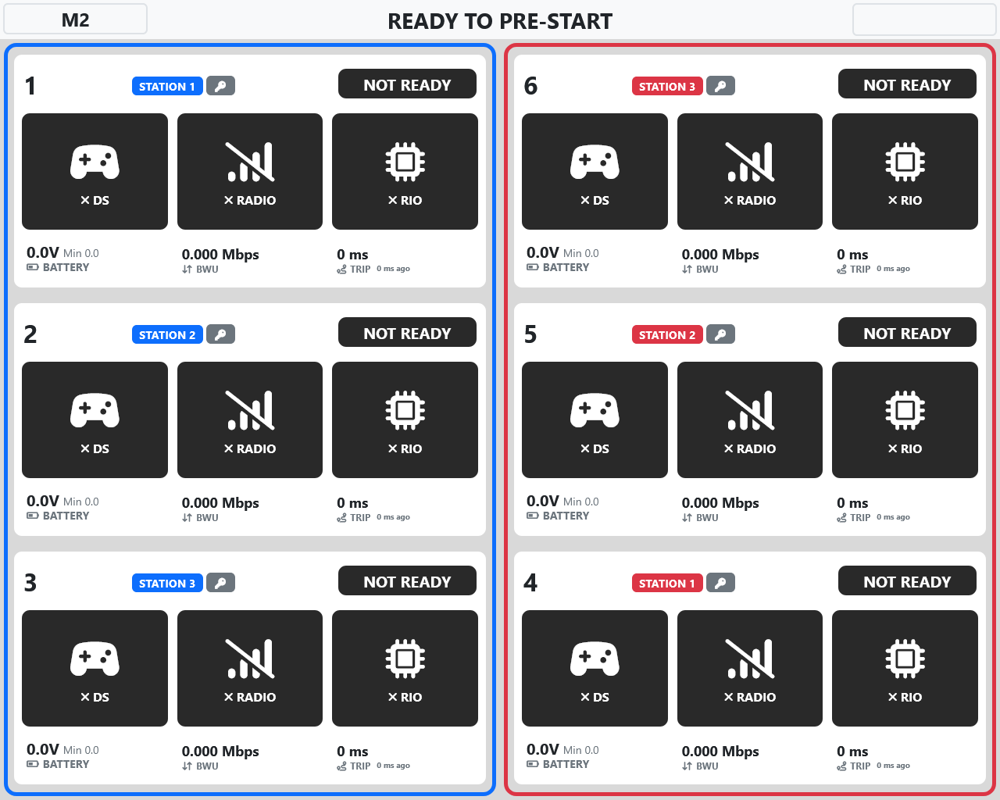

The full layout without the statistics row.

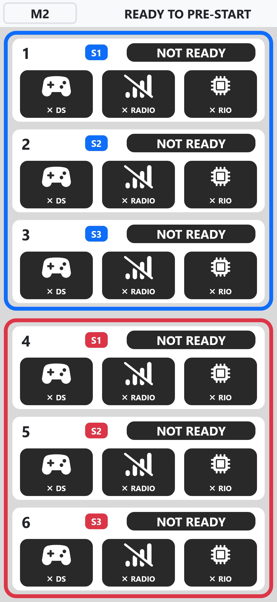

| 
| The compact layout. It needs a window about 650 tall to show all six stations, so hold a phone upright.

Common displays
^^^^^^^^^^^^^^^

This is what a display shows with the browser in full screen at 100% zoom.

.. list-table::
   :header-rows: 1
   :widths: 22 18 60

   * - Display
     - Windows scaling
     - Result
   * - 1920x1080
     - 100% or 125%
     - Everything is shown.
   * - 1920x1080
     - 150%
     - The statistics row is hidden. Set the browser zoom to 80%, or change the Windows display scaling to 125%. A zoom of
       90% is not enough.
   * - 1366x768
     - 100%
     - Battery, BWU and trip time are shown; packet loss is not. Leave the zoom at 100%, because at 90% the statistics row
       is hidden.
   * - 1366x768
     - 150%
     - The compact layout is shown. Change the Windows display scaling to 100%.

A browser that is not in full screen loses height to its tabs, address bar and the Windows taskbar. On a 1366x768 display
that is enough to hide the statistics row, so use full screen. A browser snapped to half of a 1920x1080 display shows the
compact layout.

Hidden detail message
^^^^^^^^^^^^^^^^^^^^^

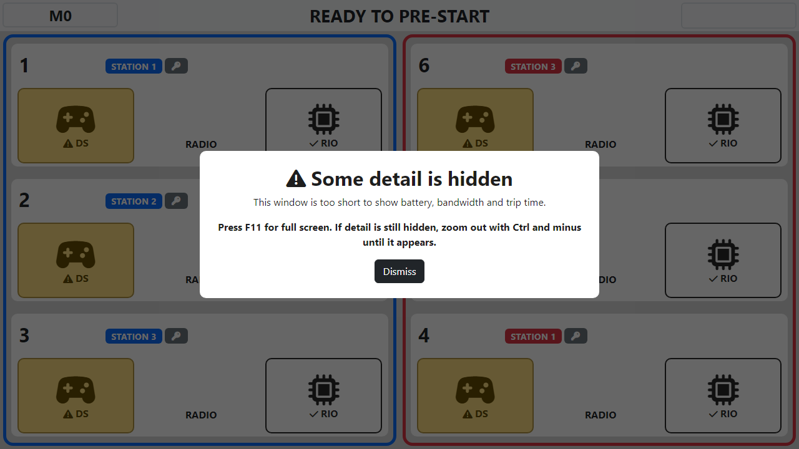

If the Field Monitor is opened in a window that is too small for the statistics row, or that is showing the compact layout on
something wider than a phone, it shows a message saying what is hidden and how to fix it. The message goes away when any of
these happens:

- The window becomes large enough, for example after pressing F11 or zooming out.
- It is clicked, or :kbd:`Esc` is pressed.
- Five seconds pass.

The message is only shown when the page is first opened. Making the window smaller afterwards does not bring it back.