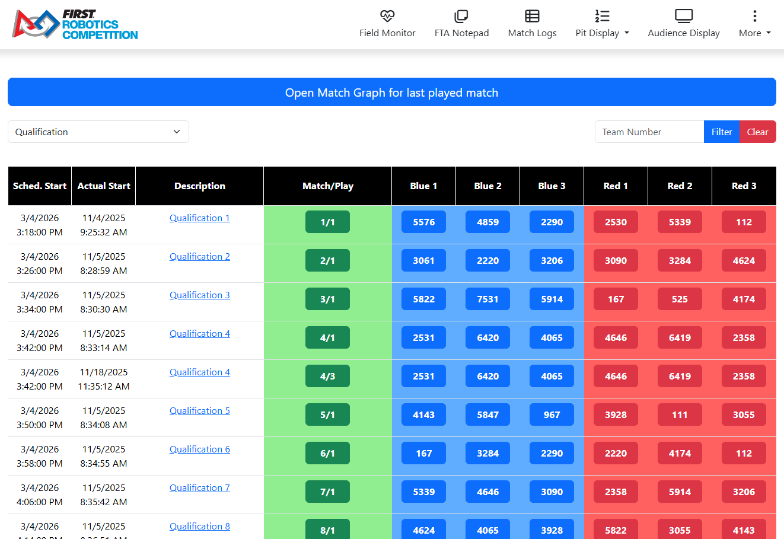
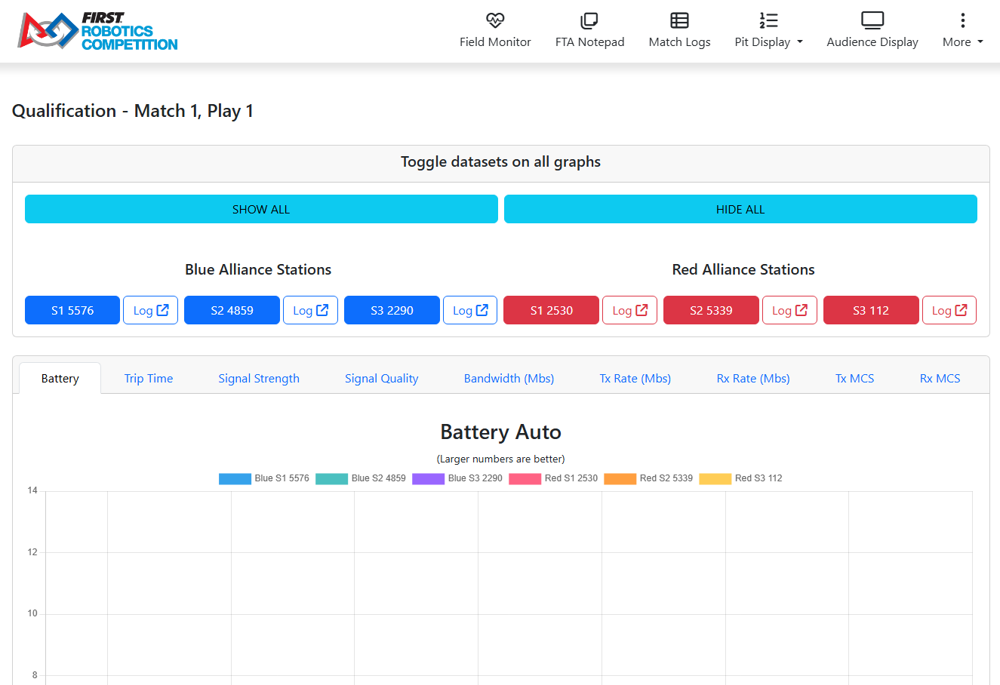
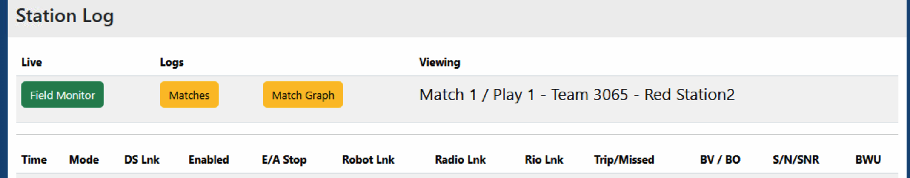
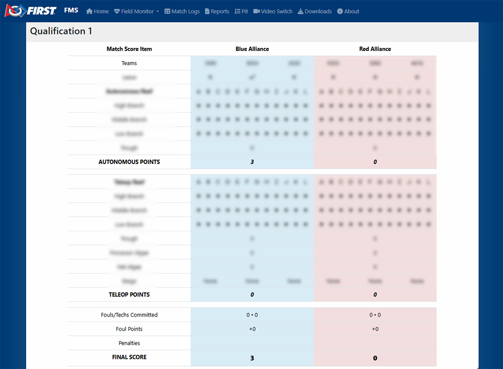

.. _field-server-logs-scores:

Match Logs and Scores
======================

Access
------

|
| Selecting the Match Logs button in the upper left hand corner of the Field Monitor presents a list of all completed matches. Users can select the Match
    Type using the dropdown box in the top center and then scroll to the desired match or search by team using the box in the top right. Clicking the green "Match/Play"
    button for a match will pull up the match graphs. Clicking an individual team button will pull up the station log for that match. Click the Field Monitor button to
    go back to the standard (Simple) Field Monitor display. Clicking on the Match Description will bring up the scoring details, as described later.

Additional details of the match list:

* The dropdown offers four choices: Test Match, Practice, Qualification and Playoff. When the page is first opened it shows the event's active tournament level.
* After a level is chosen from the dropdown, it is kept in the page address. Using the browser's Back button from a match graph or score detail returns to the list for that same level.
* To search by team, enter a number in the Team Number box and click *Filter*. Only matches at the selected level in which that team played are listed. The red *Clear* button empties the box and shows all matches for the level again.
* Team buttons open the station log in a new browser tab.
* Once a match has been played, an *Open Match Graph for last played match* button is shown above the list.

Match Graph
-----------

|
| Clicking a match number from the logs page will bring up the Match log page. The Match log page has tabs to view diagnostic information for each team in a match on a graph.
    Add or remove a team from the chart by clicking their station/team number, and navigate the tabs to view the various charts.
    The top chart is for Auto and the lower chart is for Teleop.

The tabs, and the guidance shown above each chart, are:

* Battery - larger numbers are better
* Trip Time - smaller numbers are better
* Signal Strength - larger numbers are better, 0 is disconnected
* Bandwidth (Mbs) - bandwidth utilization; smaller numbers are better
* Tx Rate (Mbs) - larger numbers are better
* Rx Rate (Mbs) - larger numbers are better

The controls above the tabs apply to every chart on every tab:

* *SHOW ALL* and *HIDE ALL* add or remove all six stations at once.
* The station buttons (S1, S2 and S3 with the team number, blue on the left and red on the right) add or remove that one station.
* The *Log* button beside each station button opens that station's Station Log in a new browser tab.

Station Log
-----------

|
| Clicking the "Log" button next to a team number from the logs page will bring up the Station Log. The station log contains a table of timestamped entries of the data shown on the Field Monitor
    during the match. This detail page is accessed by clicking the Team number (blue or red buttons) on the "Matches" page.

The table has the following columns:

* Time - match time of the entry
* Mode - Auto or Teleop
* DS Lnk - Yes or No
* Enabled - Yes or No
* E/A Stop - "E" when the E-Stop is pressed, "A" when only the A-Stop is pressed, otherwise No
* Robot Lnk - Yes or No
* Radio Lnk - Yes or No
* Rio Lnk - Yes or No
* Trip/Missed - trip time and missed packets
* BV / BO - battery voltage (V), and Yes or No for brownout
* S/N/SNR - signal (dBm), noise (dBm) and SNR
* BWU/Tx/Rx - bandwidth utilization, Tx rate and Rx rate

A "No" in any of the link columns, an "E" or "A" stop, and a brownout "Yes" are highlighted in red so that problems stand out when scrolling. Hovering over the BV / BO, S/N/SNR and BWU/Tx/Rx
column headers shows what the abbreviations mean.

If nothing was recorded for the station, the page shows "There is no log data saved for this station in this match." instead of the table.

Score Detail
------------

|
| Scoring details can be viewed from the match logs interface, freeing the scorekeeper to continue running matches instead of entering Match Review. No edits can be made through
    the web. All information on the score detail page is considered "for reference only" and the only official source of information remains the Scorekeeper.

The Score Detail shown here is in a slightly different format than the data shown on the frc-events website (to the public). This is also where FMS shows the string it
transmitted to the Robots (in the blue box at the top of the page) for seasons with a game-specific data transmission.

For a Playoff match in which a tied score was decided by the playoff tiebreakers, a yellow "Tiebreaker Applied!" banner is shown at the top of the page with the reason below it. The banner also appears when
no tiebreaker could separate the alliances and the match was recorded as a true tie.
