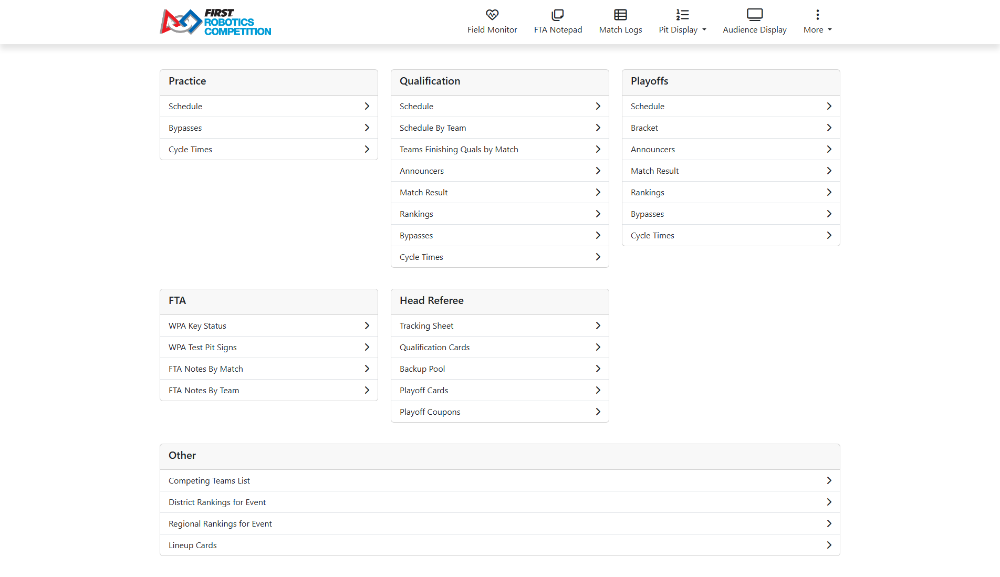
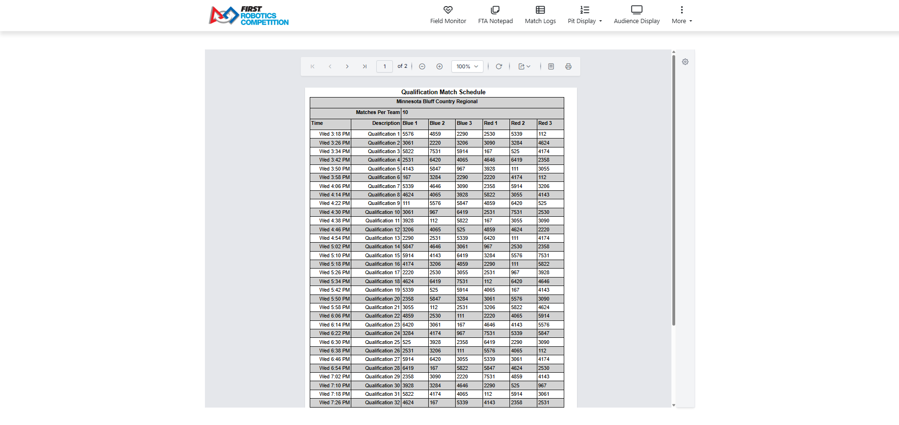

.. _field-server-reports:

Field Reports
======================

Reports can be viewed from the field server similar to how they can be accessed via the :ref:`Reports tab <reports-reports-index>` in FMS.

Click on a report to open it in the browser based viewer.

The reports are listed in six groups:

* Practice

   * Schedule
   * Bypasses
   * Cycle Times

* Qualification

   * Schedule
   * Schedule By Team
   * Teams Finishing Quals by Match
   * Announcers
   * Match Result
   * Rankings
   * Bypasses
   * Cycle Times

* Playoffs

   * Schedule
   * Bracket
   * Announcers
   * Match Result
   * Rankings
   * Bypasses
   * Cycle Times

* FTA

   * WPA Key Status
   * WPA Test Pit Signs
   * FTA Notes By Match
   * FTA Notes By Team

* Head Referee

   * Tracking Sheet
   * Qualification Cards
   * Backup Pool
   * Playoff Cards
   * Playoff Coupons

* Other

   * Competing Teams List
   * District Rankings for Event
   * Regional Rankings for Event
   * Lineup Cards

Each report is described on the :ref:`Reports <reports-reports>` page. The *FTA Team WPA Report* and the Awards Reports are not available from the website; run them from the Reports tab in FMS.

The browser viewer frame is nearly identical to the one inside FMS.

For additional operations, such as print or export, see the :ref:`Report Operations <reports-operations>` page
