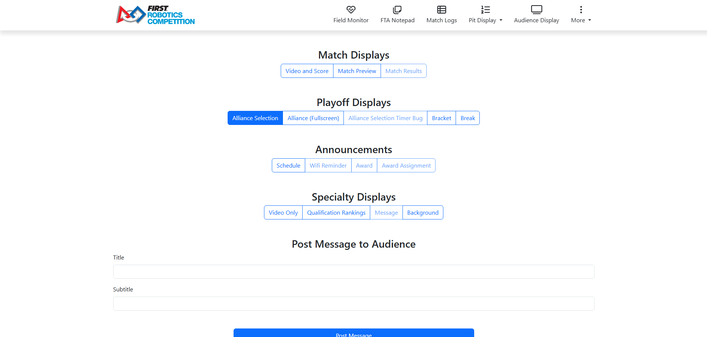

.. _field-server-video-switch:

Video Switch
======================

The output of the Audience Display(s) on the field network can be changed using the video switch buttons.
A blue background is applied to the display that was showing on the Audience Display(s) when the page was opened, or to the last button selected on this page.
The highlight does not follow changes made afterwards from within FMS or from another browser; refresh the page to update it.
Some displays cannot be activated from the web version and are shown as disabled. A disabled button is still highlighted
if that display was showing when the page was opened.

Post Message to Audience
------------------------

A message can be shown on the Audience Display(s) from the bottom of the page. Enter a *Title* and, optionally, a
*Subtitle* (up to 60 characters each) and select *Post Message*. The Audience Display(s) switch to the Message display
showing that text, the same as when a message is sent from the :doc:`Message tab </event-manager/match-play-test/message-tab>`
in FMS.

The *Message* button under Specialty Displays is disabled. It only indicates that a message is currently showing.

.. warning::
   This page does not require a login, so anyone connected to the field network can change the Audience Display or
   post a message. Coordinate with the Scorekeeper before using it.
