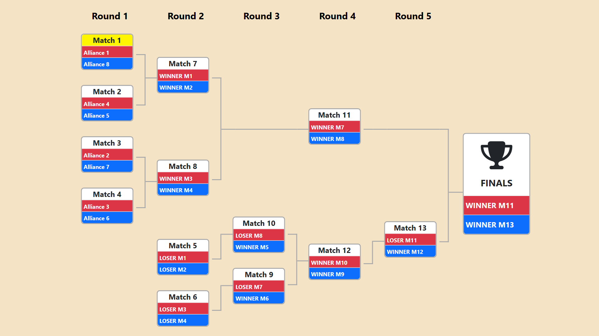
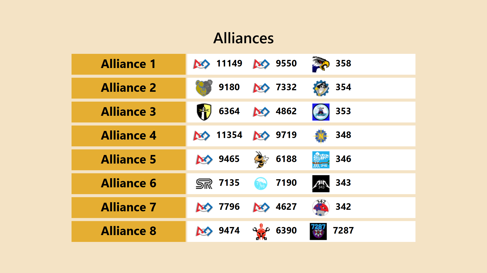

.. _pit-display-playoffs:

Playoffs Pit Display
======================

| 
| 

| 
| The Playoff Pit Display shows the same bracket screen as the Audience Display (as described :ref:`on this page <audience-playoff-displays>`). The Pit Display will transition between two screens: the Bracket and the list of Alliances.

Match Result Overlay
--------------------

When the results of a Playoff match are shown on the Audience Display, each Pit Display that is showing the Playoff screens also announces the result:

* About 10 seconds after the results are posted, an overlay appears over the display for about 10 seconds.
* The overlay shows a "Match completed" line with the match number, followed by a red line and a blue line. Each line says either which match that alliance advances to, or that the alliance is eliminated.
* The Bracket itself is refreshed with the new result at the same time.

The overlay is shown in the language selected for that Pit Display.

The overlay is triggered when the Scorekeeper uses *Post Results*, and again whenever a Playoff match result is re-posted from Match Review. It is not shown when results are posted
without display. A Pit Display that is opened after the results were posted does not show the overlay for that match, but its Bracket is up to date.
